# Registro Arquitetural — Educação Continuada Gamificada (Grupo 7)

Registro vivo do **Exercício B1 — Architecture Lab**. Cada desafio deixa uma decisão rastreável:

> **RF → RNF (FURPS+) → ASR + RPC → alternativas/trade-offs → ADR → C4 → evidência**

Regra de ouro usada na revisão: o C4 é explicado pelo ADR; o ADR é sustentado pelos ASRs e RPCs; os ASRs derivam de RF/RNF; a evidência mostra que o raciocínio é plausível.

| Desafio | Tema | ADR | C4 | Evidência | Status |
|---|---|---|---|---|---|
| 1 | Drivers e evolução do Core | [ADR-001](#18-adr-001--monólito-modular-para-o-core) | [Container](#19-c4--container) | [desafio-1](evidencias/desafio-1) | Concluído |
| 2 | Organização interna do Core | [ADR-002](#28-adr-002--ports--adapters-no-módulo-aluno) | [Component](#29-c4--component-do-core) | [desafio-2](evidencias/desafio-2) | Concluído |
| 3 | Serviço Python e IA | [ADR-003](#38-adr-003--serviço-python-independente-para-a-ia) | [Container](#39-c4--container-fronteira-da-ia-e-protocolos) | [desafio-3](evidencias/desafio-3) | Concluído |
| 4 | Comunicação e eventos | [ADR-004](#48-adr-004--notificação-assíncrona-com-rabbitmq-e-outbox-transacional) | [Container + sequência](#49-c4--container-e-sequência-do-fluxo-crítico) | [desafio-4](evidencias/desafio-4) | Concluído |
| 5 | IoT e MQTT | [ADR-005](#58-adr-005--eventos-iot-por-mqtt-com-gateway-tradutor-e-deduplicação-no-core) | [Container + sequência](#59-c4--container-borda-iot-e-sequência) | [desafio-5](evidencias/desafio-5) | Concluído |
| 6 | CI/CD e observabilidade | [ADR-006](#68-adr-006--esteira-com-caminhos-por-componente-e-métricas-ligadas-aos-asrs) | [Deployment + final](#69-c4--deployment-e-c4-final) | [desafio-6](evidencias/desafio-6) | Concluído |

---

## 0. Case-base e premissas globais

**Sistema de partida (AC1):** frontend Vue.js servido por Nginx, API Java 21 / Spring Boot 4.1, PostgreSQL 17, tudo em Docker Compose. Equipe de 6 desenvolvedores. O domínio implementado cobre as US 1 a 4 (plano, voucher, cursos extras, notificação de mudança de plano).

### Requisitos funcionais do B1 e como aparecem no código

| RF | Descrição | Origem no produto | Onde está |
|---|---|---|---|
| RF01 | Ranking | Novo no B1 (mínimo: top N por cursos concluídos) | módulo `ranking`, `GET /ranking` |
| RF02 | Conquistas e regras de gamificação | US 2 (12 cursos → PREMIUM + voucher), US 1/US 4 (média ≥ 7,0 → 3 cursos extras), US 3 (registro de notificação) | `aluno.domain.Aluno` |
| RF03 | Recomendação inteligente | — | Desafio 3 |
| RF04 | Assistente educacional (RAG/LLM) | — | Desafio 3 |
| RF05 | Notificações | US 3 (hoje é um `PUT /notificar` manual) | Desafio 4 |
| RF06 | Eventos IoT | Laboratórios (presença, início e conclusão de atividade) | módulo `iot` + `iot-gateway`, `POST /iot/eventos` (Desafio 5) |

> **Premissa:** o produto ainda não tem moedas nem badges. Neste registro, "conquistas" corresponde às recompensas que já existem (plano PREMIUM, voucher e cursos extras). Moedas e badges entram como novas regras do domínio, sem alterar a estrutura decidida no ADR-002.

### RPCs globais (valem para todos os desafios)

| ID | Restrição / premissa | Tipo |
|---|---|---|
| RPC-01 | O Core permanece em Java/Spring Boot | Tecnologia / legado |
| RPC-02 | Equipe de 6 desenvolvedores, sem time de plataforma dedicado | Equipe |
| RPC-03 | Banco relacional (PostgreSQL) e dados da AC1 | Legado / dados |
| RPC-04 | O contrato HTTP/JSON usado pelo frontend Vue não pode quebrar sem ajuste coordenado | Integração |
| RPC-05 | Ambiente de execução em Docker Compose | Infraestrutura |
| RPC-06 | ML e RAG/LLM são implementados em Python (a partir do D3) | Tecnologia |
| RPC-07 | A indisponibilidade da IA não pode bloquear o fluxo essencial (a partir do D3) | Premissa de negócio |
| RPC-08 | As operações essenciais do Core concluem mesmo com um consumidor externo indisponível (a partir do D4) | Premissa de negócio |
| RPC-09 | Adotar um broker exige custo operacional (a partir do D4) | Operação |
| RPC-10 | Os dispositivos dos laboratórios têm baixo poder computacional (a partir do D5) | Hardware / integração |
| RPC-11 | A conectividade dos laboratórios é intermitente (a partir do D5) | Infraestrutura |
| RPC-12 | O protocolo e o broker de IoT adicionam componentes para operar (a partir do D5) | Operação |
| RPC-13 | O Jenkins é a base da esteira (a partir do D6) | Ferramenta / processo |
| RPC-14 | Prometheus e Grafana são as ferramentas de observabilidade do laboratório (a partir do D6) | Ferramenta / operação |
| RPC-15 | Artefatos e configurações são versionados no repositório (a partir do D6) | Processo |

---

## Matriz cumulativa de ASRs

Só entram aqui RNFs capazes de alterar estrutura, comunicação, dados, implantação ou operação. O ID do ASR é permanente; desafios futuros acrescentam linhas ou atualizam o status.

| ID | ASR (cenário) | RNF / FURPS+ | Desafio | Altera | ADR | Evidência | Status |
|---|---|---|---|---|---|---|---|
| ASR-01 | Uma mudança em uma capacidade (ex.: ranking) deve alterar só o módulo dela; outro módulo só a acessa pela API pública | Manutenibilidade / **S** | D1 | Estrutura | ADR-001 | `ArquiteturaModularTest` + grafo jdeps | Atendido |
| ASR-02 | Com até 100.000 usuários, o ranking (leitura que mais cresce) não pode carregar todos os alunos nem competir com a conclusão de curso; deve ser extraível sem reescrever o aluno | Escalabilidade e desempenho / **P** | D1 | Dados, implantação futura | ADR-001 | Consulta top N paginada + fronteira `aluno.api`; p95 por rota no Prometheus (D6) | Parcial: métrica disponível, falta teste de carga com 100 mil usuários |
| ASR-03 | A arquitetura deve continuar operável por 6 devs: um artefato implantável enquanto não houver necessidade medida de deploy ou escala independente | Complexidade operacional / **S** (+ restrição de equipe) | D1 | Implantação, operação | ADR-001 | Compose segue com 1 container de backend | Atendido |
| ASR-04 | Alterar uma regra de gamificação (ex.: 12 cursos, média 7,0) deve exigir mudança em um único lugar, o domínio, sem tocar controller nem banco | Modificabilidade / **S** | D2 | Estrutura interna, dependências | ADR-002 | Regra dos 12 cursos: 2 lugares → 1; `ArquiteturaHexagonalTest` | Atendido |
| ASR-05 | Regras e casos de uso devem ser testáveis sem Spring e sem banco; o adapter de persistência deve ser trocável sem mudar os testes do domínio | Testabilidade / **S** | D2 | Estrutura (portas) | ADR-002 | Contrato da porta rodando em 2 adapters; 23 testes de comportamento sem infraestrutura | Atendido |
| ASR-06 | Um modelo novo (recomendação ou assistente) vai para produção sem rebuild nem redeploy do Core | Deploy independente / **S** (+ implantação) | D3 | Implantação | ADR-003 | Container `ia-service` próprio + `modeloVersao` em cada resposta | Atendido |
| ASR-07 | Com a IA fora do ar ou lenta, o fluxo essencial responde normalmente; a recomendação degrada em até 2 s e o assistente informa indisponibilidade | Tolerância a falhas / **R** | D3 | Comunicação | ADR-003 | `IaApiIntegrationTest`, `IaHttpClientTest`, `lab-ia.ps1`; métrica `gamificacao_recomendacoes_total{origem}` (D6) | Atendido |
| ASR-08 | Picos de uso da IA são absorvidos escalando só o `ia-service` (sem estado, sem banco do Core) | Escalabilidade / **P** | D3 | Implantação | ADR-003 | Serviço stateless; o Core envia o contexto; caminho próprio na esteira (D6) | Parcial: escala sob carga não medida |
| ASR-09 | Com o consumidor de notificação ou o broker fora do ar, a conclusão de curso responde 200 e a recompensa é aplicada | Disponibilidade / tolerância a falhas / **R** | D4 | Comunicação | ADR-004 | `NotificacaoAssincronaIntegrationTest`, `lab-eventos.ps1` (cenários 1 e 2); 0 conclusões com erro no `lab-observabilidade.ps1` (D6) | Atendido |
| ASR-10 | Nenhuma promoção fica sem notificação: o evento é entregue quando o consumidor ou o broker voltam (pelo menos uma vez) | Recuperabilidade / **R** | D4 | Dados, operação | ADR-004 | Outbox + fila durável; `lab-eventos.ps1`; outbox e fila voltando a 0 no Prometheus (D6) | Atendido |
| ASR-11 | Conclusão, recompensa e registro do evento são atômicos; só a entrega da notificação é eventual | Consistência / **R** (integridade) | D4 | Dados | ADR-004 | Outbox na mesma transação; `NotificacaoSincronaIntegrationTest` mostra a alternativa | Atendido |
| ASR-12 | Com o dispositivo, o gateway ou o Core fora do ar, nenhum evento IoT se perde e nenhum conta duas vezes | Tolerância à conectividade intermitente / **R** | D5 | Comunicação, dados | ADR-005 | Deduplicação por `eventoId` (UNIQUE); `EventoIotApiIntegrationTest`; `lab-iot.ps1` (cenários 2 a 5) | Atendido |
| ASR-13 | O dispositivo publica um evento em poucas dezenas de bytes numa conexão persistente, sem uma requisição HTTP por evento | Eficiência de comunicação / **P** | D5 | Comunicação | ADR-005 | MQTT QoS 1; 71 bytes por evento no `lab-iot.ps1` | Atendido |
| ASR-14 | O Core não conhece dispositivos nem MQTT: um formato novo de aparelho muda só o tradutor do gateway | Interoperabilidade / **S** | D5 | Estrutura, comunicação | ADR-005 | `ArquiteturaIotTest`; `iot-gateway/tests/test_traducao.py` | Atendido |
| ASR-15 | Cada decisão arquitetural tem uma métrica que mostra, em funcionamento, se ela se sustenta (fallback da IA, eventos parados, essencial respondendo) | Observabilidade / **S** (operação) | D6 | Operação, estrutura | ADR-006 | `MetricasArquiteturaIntegrationTest`, `lab-observabilidade.ps1` (13 de 13), dashboard no Grafana | Atendido |
| ASR-16 | Um componente que mudou é testado e implantado sem reconstruir nem reimplantar os outros; a falha de um não bloqueia os demais | Deploy independente / **S** (implantação) | D6 | Implantação | ADR-006 | `Jenkinsfile`; builds #4 (só o `ia-service`) e #5 (Core barrado, `ia-service` implantado) | Atendido |
| ASR-17 | Nada chega à homologação sem passar nos testes, nas regras ArchUnit e no smoke test | Confiabilidade da entrega / **R** (+ testabilidade) | D6 | Implantação, operação | ADR-006 | Build #5: violação do ADR-001 bloqueou imagem e homologação do Core | Atendido |

---

# Desafio 1 — Drivers e evolução do Core

**Pergunta:** manter o monólito em camadas, evoluir para monólito modular ou separar capacidades em serviços, num cenário de 1.000 → 100.000 usuários em que o ranking cresce mais que o resto?

## 1.1 RF

- **RF01 Ranking:** não existia na AC1. Criado no módulo `ranking` (`GET /ranking?limite=N`, top N por cursos concluídos).
- **RF02 Conquistas:** regras das US 1 a 4, que continuam evoluindo.
- Evolução das funcionalidades existentes (cadastro, conclusão de curso, liberação de cursos, notificação).

## 1.2 RNF analisados (FURPS+)

| RNF | FURPS+ | Leitura no cenário | Vira ASR? |
|---|---|---|---|
| Manutenibilidade | S | As 4 US cresceram no mesmo controller, e novas capacidades (IA, eventos, IoT) vão chegar | **Sim → ASR-01** |
| Desempenho | P | O ranking é a leitura mais frequente | Incorporado ao ASR-02 (mesma causa) |
| Escalabilidade | P | 100× mais usuários, com crescimento concentrado no ranking | **Sim → ASR-02** |
| Testabilidade | S | Os testes cobriam um domínio que a API não usava | Não neste desafio: não muda a decisão macro. Vira o **ASR-05** no D2 |
| Complexidade operacional | S (+) | 6 devs, Docker Compose, sem time de plataforma | **Sim → ASR-03** |

## 1.3 ASRs selecionados (máx. 3)

1. **ASR-01 Manutenibilidade.** Altera a **estrutura**: o código passa a ser organizado por capacidade de negócio, com uma API pública por módulo, em vez de camadas técnicas compartilhadas.
2. **ASR-02 Escalabilidade do ranking.** Altera os **dados** (consulta top N paginada no banco, não `findAll`) e prepara a **implantação** futura: o ranking pode virar serviço sem mexer no aluno.
3. **ASR-03 Complexidade operacional.** Altera **implantação e operação**: mantém um único artefato até existir evidência que justifique distribuir.

## 1.4 RPCs aplicáveis

- RPC-01 Core em Java/Spring Boot.
- RPC-02 Equipe de 6 desenvolvedores.
- RPC-03 Banco relacional e legado da AC1.
- RPC-04 Contrato JSON do frontend mantido.

## 1.5 Decisão do Tech Lead

- **Quais RNFs viram ASR?** Manutenibilidade, escalabilidade (com desempenho junto) e complexidade operacional. Testabilidade fica para o D2, onde é ela que decide a estrutura interna.
- **Há necessidade comprovada de escala ou deploy independente?** **Ainda não.** O Core tem 1 entidade, 1 tabela e nenhuma medição mostrando o ranking competindo por recursos com a conclusão de curso. Os 100.000 usuários são uma projeção. A resposta proporcional é tirar o gargalo óbvio (consulta paginada no banco) e deixar a fronteira pronta para extrair o ranking. A medição fica para o D6 (Prometheus/Grafana).
- **A complexidade distribuída é justificável?** Não para o Core. Serviços exigiriam rede entre módulos, consistência eventual, rastreamento distribuído e um pipeline por serviço, tudo com 6 pessoas. A capacidade de IA em Python, que tem outra stack e outro ciclo de vida, será decidida no D3 por ASRs próprios.

## 1.6 Alternativas e trade-offs

| | (A) Monólito em camadas (AC1) | **(B) Monólito modular** | (C) Decomposição seletiva (ranking como serviço) |
|---|---|---|---|
| Como fica | Pacotes `Controller/Service/Repository/Entity` compartilhados por todas as funcionalidades | Pacotes por capacidade (`aluno`, `ranking`), cada módulo com API pública; 1 deploy | Ranking em serviço próprio, com banco/cache próprio e comunicação HTTP ou eventos |
| Ganha | Simplicidade imediata | Fronteiras explícitas e testáveis; extração futura barata; zero custo operacional novo | Escala e deploy independentes do ranking |
| Perde | Qualquer classe acessa entidade e repositório; o crescimento espalha acoplamento (o controller já duplicava regras) | Escala ainda conjunta (o ranking escala junto com o Core) | +1 pipeline, +1 banco ou réplica, consistência eventual do placar, latência de rede, observabilidade distribuída |
| Atende ASR-01 / 02 / 03 | ✗ / parcial / ✓ | ✓ / ✓ (preparado) / ✓ | ✓ / ✓ / ✗ |
| Veredito | Rejeitada | **Escolhida** | Adiada até haver medição (gatilho no ADR-001) |

## 1.7 Evidência (mini-lab)

**Hipótese:** reorganizar por capacidade, com API pública explícita, reduz o acoplamento entre funcionalidades sem custo operacional, e a fronteira pode ser verificada automaticamente.

**Procedimento**
1. Grafo de dependências das classes compiladas **antes** da mudança, gerado com `jdeps` a partir da versão em camadas da AC1 ([commit `4ae2fd0` do repositório da AC1](https://github.com/KauanHYT/devops-ac1---entrega-final-atdd-em-spring-boot-e-docker/tree/4ae2fd0)).
2. Reorganização: `aluno/` (com `api/`) e o novo `ranking/`, que consome só `aluno.api.ProgressoAlunoConsulta`.
3. Grafo **depois** e regras ArchUnit em [`ArquiteturaModularTest`](../../src/test/java/com/grupo7/ac1final/arquitetura/ArquiteturaModularTest.java).

| Antes (AC1) | Depois (D1) |
|---|---|
| 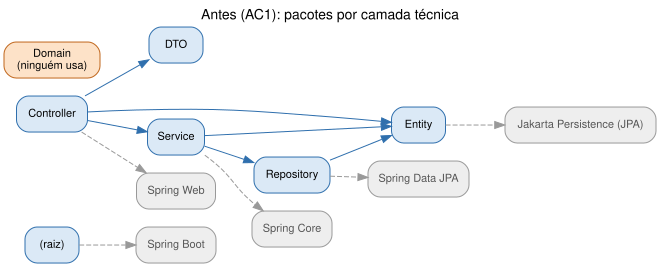 | 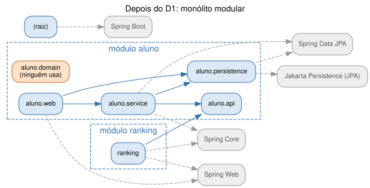 |

| Medida | Antes | Depois |
|---|---|---|
| Organização | Por camada técnica (`Controller`, `Service`, `Repository`, `Entity`, `DTO`, `Domain`) | Por capacidade: módulos `aluno` e `ranking` |
| Fronteira pública entre funcionalidades | Nenhuma: qualquer classe acessa `AlunoEntity` e o repositório | `aluno.api`, com 2 tipos |
| Dependências do ranking (jdeps) | — | Somente `aluno.api` + Spring Web/Core |
| Consulta do ranking | — | Top N paginado no banco (`findAllByOrderByCursosConcluidosDescIdAsc(Pageable)`) |
| Regras de fronteira verificadas no build | 0 | 3 (ranking → só `aluno.api`; aluno não depende de ranking; módulos sem ciclos) |
| Ciclos entre módulos | n/a | 0 |
| Artefatos implantáveis | 1 | 1 (sem custo operacional novo) |
| Observação | O pacote `Domain` não era usado por nenhuma classe | Resolvido no D2 |

Dados brutos: [`dependencias-antes.txt`](evidencias/desafio-1/dependencias-antes.txt) e [`dependencias-depois.txt`](evidencias/desafio-1/dependencias-depois.txt).

**Como reproduzir**
```bash
./mvnw test -Dtest=ArquiteturaModularTest,RankingServiceTest
./mvnw -q compile && jdeps -verbose:package target/classes
```

**Limitação assumida:** a escalabilidade não foi medida com carga. O ASR-02 fica "Parcial" até o D6 instrumentar a latência de `/ranking` e de `/concluir-curso`.

## 1.8 ADR-001 — Monólito modular para o Core

- **Status:** Aceito (2026-11-01). Substitui o ADR resumido do registro da AC2.
- **Contexto:** crescimento projetado de 1.000 para 100.000 usuários, com o ranking crescendo mais que o resto. O Core da AC1 era organizado por camada técnica, sem fronteira entre funcionalidades, e o controller já duplicava regras do domínio.
- **ASRs / RPCs:** ASR-01, ASR-02, ASR-03 · RPC-01, RPC-02, RPC-03, RPC-04.
- **Alternativas:** (A) monólito em camadas; (B) monólito modular; (C) ranking como serviço. Comparação em 1.6.
- **Decisão:** adotar **(B)**. O Core passa a ser dividido em módulos por capacidade (`aluno`, `ranking`). A comunicação entre módulos só passa por APIs públicas (`aluno.api`), e as regras de fronteira viram testes ArchUnit. O deploy continua único.
- **Consequências:**
  - (+) Fronteiras explícitas e verificadas no build.
  - (+) Extrair o ranking passa a ser trocar a implementação de `ProgressoAlunoConsulta` por um cliente HTTP ou de eventos.
  - (+) Nenhum container ou pipeline novo.
  - (−) Ranking e aluno ainda escalam juntos e compartilham o banco.
  - (−) A disciplina de fronteira depende dos testes ArchUnit continuarem no pipeline (D6).
- **Revisitar quando:** métricas do D6 mostrarem que a carga do ranking degrada a latência p95 da conclusão de curso, que o ranking precisa de réplica ou cache próprio, ou que a equipe cresceu a ponto de times diferentes cuidarem de módulos diferentes.

## 1.9 C4 — Container

A decisão é interna ao Core: a visão de containers não ganha elementos novos, mas o Core passa a ser descrito como monólito modular. A organização interna aparece no C4 Component (Desafio 2).

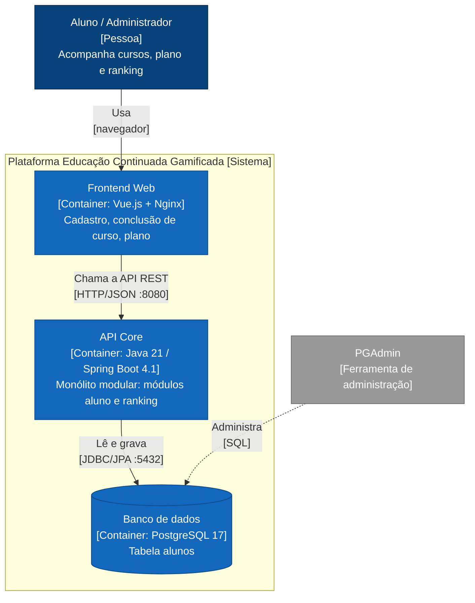

---

# Desafio 2 — Organização interna do Core

**Pergunta:** como evitar que domínio, banco, framework e integrações fiquem acoplados, se as regras de ranking, moedas, badges e recompensas mudam com frequência?

## 2.1 RF

- **RF01 Ranking:** consome o progresso dos alunos pela API do módulo.
- **RF02 Conquistas e regras de gamificação:** US 2 (12 cursos → PREMIUM + voucher), US 1/US 4 (média ≥ 7,0 → 3 cursos extras), US 3 (notificação só para PREMIUM).

## 2.2 RNF analisados (FURPS+)

| RNF | FURPS+ | Leitura no código da AC1 | Vira ASR? |
|---|---|---|---|
| Modificabilidade | S | A regra dos 12 cursos existia em 2 lugares (`Aluno` e `AlunoController`) e a da média já divergia: a API liberava 3 cursos sem olhar a média | **Sim → ASR-04** |
| Testabilidade | S | Os 7 testes cobriam uma classe que nenhuma classe de produção usava; testar a API exigia Spring + banco | **Sim → ASR-05** |
| Manutenibilidade | S | Já tratada no nível de módulos pelo ASR-01 | Não (evita duplicar ASR) |
| Facilidade de evolução | S | É consequência de ASR-01 + ASR-04 | Não |

## 2.3 ASRs selecionados

1. **ASR-04 Modificabilidade das regras.** Altera a **estrutura interna**: a regra mora só no domínio, e controller e persistência ficam proibidos de reimplementá-la.
2. **ASR-05 Testabilidade.** Altera as **dependências**: a aplicação passa a depender de uma porta (interface), e não do JPA. Assim, domínio e casos de uso rodam com um adapter falso.

Ficamos com 2 ASRs de propósito: os outros RNFs já estão cobertos por ASRs existentes.

## 2.4 RPCs aplicáveis

- O Core continua em Spring Boot (RPC-01). Não vamos tirar `@Service`/`@Transactional` da camada de aplicação.
- As regras existentes devem ser reaproveitadas: a classe `Aluno` e seus 7 testes seguem sem mudança de comportamento. Só ganharam `id`, `getCursosConcluidos()` e `reconstituir(...)`.
- É proibido reescrever o produto. O contrato JSON foi mantido (RPC-04), com uma única mudança: `PUT /alunos/{id}/liberar-cursos` passa a exigir `?media=`, porque a regra das US 1 e 4 depende da média. O frontend foi ajustado junto.

## 2.5 Decisão do Tech Lead

- **Qual dependência realmente precisa ser invertida?** A da **persistência**. Na AC1, o controller dependia da entidade JPA e reimplementava a regra. Agora a aplicação depende de `AlunoRepositoryPort`, e o JPA fica num adapter que implementa essa porta. O framework web não precisa de inversão: o controller já é borda e só passou a delegar.
- **O custo estrutural é proporcional?** Sim, porque foi aplicado só onde as regras mudam: o módulo `aluno`, com 1 porta, 1 adapter JPA e 1 record de entrada. O módulo `ranking`, que não tem regra própria, continua simples. Não criamos uma classe por caso de uso, presenters nem mappers genéricos.
- **DDD, Hexagonal, Clean e Onion são concorrentes?** Não, eles se **combinam**:
  - **Hexagonal** define a borda: portas e adapters.
  - **Clean/Onion** define a regra de dependência: tudo aponta para o domínio.
  - **DDD** contribui com a entidade rica (`Aluno` com comportamento e linguagem do negócio) e com o recorte de módulos por capacidade.
  - Não adotamos DDD tático completo (agregados formais, eventos de domínio), porque ainda não há complexidade que pague esse custo. Eventos de domínio podem surgir no D4.

## 2.6 Alternativas e trade-offs

| | (A) Estrutura atual (camadas, controller + entidade) | **(B) Ports & Adapters no módulo aluno** | (C) Clean Architecture completa |
|---|---|---|---|
| Como fica | Controller manipula `AlunoEntity` e aplica regras; service é repasse do repositório | Domínio puro ← aplicação (casos de uso) ← adapters web e JPA, via porta | Uma classe por caso de uso, presenters, gateways, aplicação sem nenhuma anotação Spring |
| Ganha | Menos arquivos | Regra em 1 lugar; casos de uso testáveis sem infraestrutura; JPA isolado num pacote | Isolamento máximo do framework |
| Perde | Regras duplicadas e divergentes; testes não cobrem o que roda | +1 porta e +1 adapter; tradução entidade ↔ domínio | Muitos tipos para 1 entidade; contraria "não reescrever o produto" |
| ASR-04 / ASR-05 | ✗ / ✗ | ✓ / ✓ | ✓ / ✓ |
| Veredito | Rejeitada | **Escolhida** | Rejeitada por custo desproporcional |

## 2.7 Evidência (mini-lab)

**Hipótese:** com a dependência de persistência invertida, a regra de domínio fica num só lugar e testável sem infraestrutura, e o adapter de persistência pode ser trocado sem mudar domínio nem testes de domínio.

**Procedimento**
1. A API passou a chamar o domínio `Aluno`, e a regra duplicada no controller foi removida.
2. Foi criada a porta `AlunoRepositoryPort`, com dois adapters: `AlunoPersistenceAdapter` (JPA, produção) e `AlunoRepositoryEmMemoria` (fake, testes).
3. O mesmo conjunto de testes de contrato ([`AlunoRepositoryPortContrato`](../../src/test/java/com/grupo7/ac1final/aluno/application/port/AlunoRepositoryPortContrato.java)) roda contra os dois adapters.
4. As regras de dependência viraram testes em [`ArquiteturaHexagonalTest`](../../src/test/java/com/grupo7/ac1final/arquitetura/ArquiteturaHexagonalTest.java).

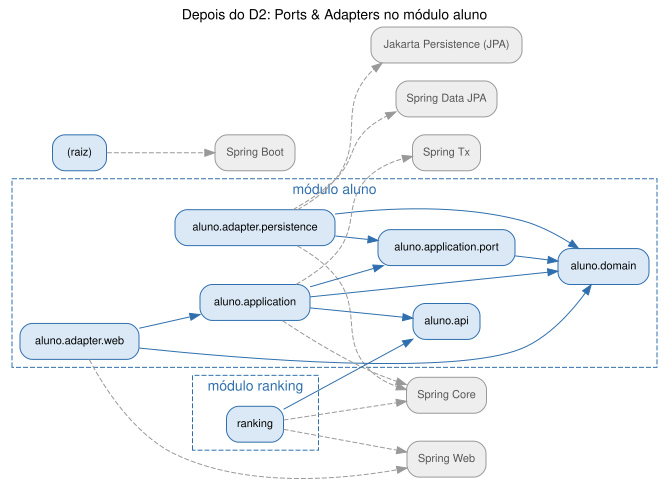

| Medida | Antes (AC1) | Depois (D2) |
|---|---|---|
| Lugares onde a regra dos 12 cursos está escrita | 2 (`Aluno`, `AlunoController`) | **1** (`Aluno`) |
| Classes de produção que usam o domínio `Aluno` | **0** | 5 |
| Classes que dependem de JPA / Spring Data / entidade | 4 (incluindo controller e service) | 3, todas em `aluno.adapter.persistence` |
| Regra "média ≥ 7,0" na API | Ignorada (sempre liberava 3) | Aplicada pelo domínio (teste de regressão) |
| Adapters da porta exercitados pelo mesmo contrato | — | 2 (memória e JPA/H2), 5 testes cada |
| `AlunoTest` (testes de domínio originais) | 7 | 7, sem alteração (só mudou o pacote) |
| Testes de comportamento que rodam sem Spring e sem banco | 7 | 23 |
| Total de testes da suíte | 8 | 39 |
| Regras de arquitetura no build | 0 | 4 hexagonais + 3 modulares |

**O que cada suíte prova**

| Suíte | Prova | Precisa de Spring/banco? |
|---|---|---|
| `AlunoTest`, `AlunoReconstituidoTest` | Regras US 1 a 4 no domínio puro | Não |
| `AlunoServiceTest` | Casos de uso com adapter em memória, incluindo a regressão da média | Não |
| `AlunoRepositoryEmMemoriaTest` | Contrato da porta no adapter fake | Não |
| `AlunoPersistenceAdapterJpaTest` | **O mesmo contrato** no adapter JPA (`@DataJpaTest`, H2) | Sim |
| `AlunoApiIntegrationTest` | HTTP → caso de uso → domínio → JPA, e `/ranking` | Sim |
| `ArquiteturaHexagonalTest`, `ArquiteturaModularTest` | Direção das dependências e fronteiras de módulo | Não (análise de bytecode) |

**Resultado da suíte completa (2026-11-02):** `Tests run: 39, Failures: 0, Errors: 0, Skipped: 0`, BUILD SUCCESS. São 31 testes de comportamento e 7 regras de arquitetura, mais o `contextLoads`.

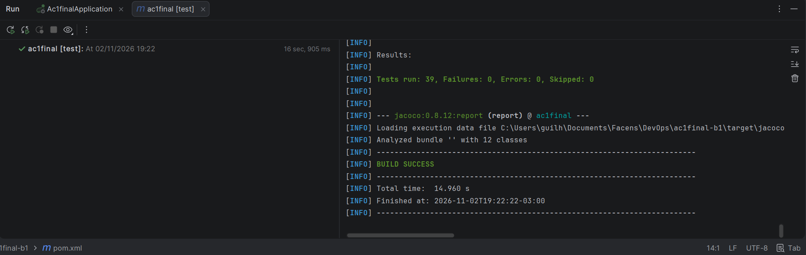

**Como reproduzir**
```bash
./mvnw test
```

**Dívida registrada:** o cadastro (`POST /alunos`) ainda aceita estado inicial vindo do cliente (comportamento da AC1, preservado pela RPC). Isso permite criar um aluno PREMIUM com 0 cursos, e vira candidato a regra de domínio quando entrarem moedas e badges.

## 2.8 ADR-002 — Ports & Adapters no módulo aluno

- **Status:** Aceito (2026-11-01).
- **Contexto:** as regras de gamificação mudam com frequência. Na AC1, o controller manipulava a entidade JPA e reimplementava regras: a dos 12 cursos estava duplicada e a da média divergia do domínio. Já o domínio testado não era usado pela API.
- **ASRs / RPCs:** ASR-04, ASR-05 · RPC-01, RPC-04, "reaproveitar regras", "não reescrever o produto".
- **Alternativas:** (A) manter camadas; (B) Ports & Adapters no módulo aluno, seguindo a regra de dependência de Clean/Onion; (C) Clean Architecture completa. Comparação em 2.6.
- **Decisão:** adotar **(B)**. O módulo `aluno` fica dividido em:
  - `domain`: Java puro;
  - `application`: casos de uso e a porta `AlunoRepositoryPort`;
  - `adapter.web`: REST;
  - `adapter.persistence`: JPA;
  - `api`: interface pública para outros módulos.

  A aplicação pode usar anotações Spring (`@Service`, `@Transactional`), mas nunca JPA nem adapters. As regras são verificadas com ArchUnit.
- **Consequências:**
  - (+) Cada regra está num lugar só.
  - (+) Casos de uso testáveis em milissegundos.
  - (+) Trocar o banco ou o ORM afeta um único pacote.
  - (+) O D3/D4 poderá acrescentar adapters (cliente da IA, publicador de eventos) sem tocar no domínio.
  - (−) Tradução entidade ↔ domínio no adapter.
  - (−) Mais tipos para quem chega ao código.
  - (−) A camada de aplicação continua acoplada ao Spring, por escolha consciente (RPC-01).
- **Revisitar quando:** o domínio ganhar várias entidades com invariantes entre si (aí avaliar agregados DDD) ou quando a aplicação precisar rodar fora do Spring.

## 2.9 C4 — Component do Core

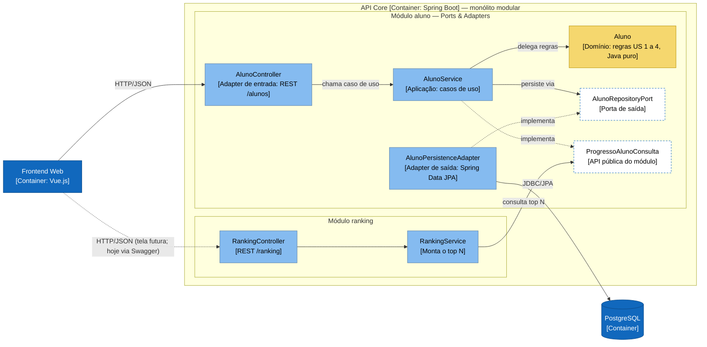

---

# Desafio 3 — Serviço Python e IA

**Pergunta:** onde fica a fronteira de ML (recomendação) e de RAG/LLM (assistente)? Os modelos são feitos em Python, têm ciclo de atualização próprio e carga variável, e podem ficar indisponíveis sem que isso impeça as operações essenciais do Core.

## 3.1 RF

- **RF03 Recomendação inteligente:** `GET /alunos/{id}/recomendacoes` no Core, que chama `POST /recomendacoes` no `ia-service`.
- **RF04 Assistente educacional:** `POST /alunos/{id}/assistente` no Core, que chama `POST /assistente/perguntas` no `ia-service`.

> **Premissa:** os modelos são **simulados** (recomendação por regras e RAG extrativo). Este desafio avalia a fronteira e o comportamento sob falha, não a qualidade do modelo. Trocar por um modelo treinado ou por um LLM real muda só o código Python; o contrato HTTP continua o mesmo.

## 3.2 RNF analisados (FURPS+)

| RNF | FURPS+ | Leitura no cenário | Vira ASR? |
|---|---|---|---|
| Deploy independente | S (+ implantação) | Os modelos são re-treinados e versionados num ciclo próprio | **Sim → ASR-06** |
| Tolerância a falhas | R | A IA pode cair ou ficar lenta; o Core não pode cair junto | **Sim → ASR-07** |
| Escalabilidade | P | Carga variável e cara (picos de perguntas ao assistente) | **Sim → ASR-08** |
| Interoperabilidade | + (interface) | Java ↔ Python | Não: é resolvida pelo contrato HTTP/JSON e decorre da RPC-06, sem mudar a decisão |
| Desempenho | P | A recomendação aparece na tela; o assistente pode demorar mais | Incorporado ao ASR-07 (orçamento de tempo por capacidade) |
| Manutenibilidade | S | Já coberta por ASR-01 e ASR-04 | Não |

## 3.3 ASRs selecionados (máx. 3)

1. **ASR-06 Deploy independente.** Altera a **implantação**: um modelo novo vai para produção sem rebuild nem redeploy do Core, porque tem container próprio e informa `modeloVersao` em cada resposta.
2. **ASR-07 Tolerância a falhas.** Altera a **comunicação**: o Core chama a IA com timeout curto e trata a falha (fallback ou indisponibilidade explícita). Também não declara dependência de inicialização em relação a ela.
3. **ASR-08 Escalabilidade independente.** Altera a **implantação**: a IA ganha réplicas, GPU ou cota de API sem escalar o Core. Para isso o serviço não guarda estado nem acessa o banco do Core.

## 3.4 RPCs aplicáveis

- RPC-01: o Core permanece em Java/Spring Boot.
- **RPC-06:** ML e RAG são implementados em Python.
- **RPC-07:** a indisponibilidade da IA não pode bloquear o fluxo essencial.

## 3.5 Decisão do Tech Lead

- **Python, por si só, justifica um serviço?** **Não.** A linguagem é uma restrição (RPC-06), não um driver: daria para rodar Python dentro da JVM (GraalPy) ou como processo filho do Core. O que justifica um serviço é a soma dos ASR-06, 07 e 08: ciclo de vida próprio, falha isolada e escala própria.
- **ML e RAG precisam da mesma fronteira?** **Por enquanto, um serviço só, mas com fronteiras internas separadas:** routers e módulos Python diferentes, duas portas no Core (`RecomendacaoIaPort` e `AssistenteIaPort`) e **timeouts diferentes** (800 ms para a recomendação e 5 s para o assistente). Ficam juntos porque são a mesma equipe, a carga é baixa e assim há um container a menos. A separação física vem quando o assistente passar a usar um LLM real; nesse momento, só muda a URL de uma das portas.
- **Quais ASRs justificam autonomia e escala?** O ASR-06 (ciclo próprio) e o ASR-08 (escala própria). O ASR-07 define como o Core se protege da fronteira.
- **Qual comportamento degradado é aceitável?**
  - **Recomendação:** o Core devolve a trilha padrão, com HTTP 200 e `origem: "PADRAO"`, para a tela saber que não é personalizada.
  - **Assistente:** HTTP 503 com mensagem clara. Não há resposta de reserva, porque uma resposta inventada é pior que nenhuma.
  - **Cadastro, conclusão de curso e ranking:** não dependem da IA.
  - **Inicialização:** o backend sobe mesmo com a IA fora do ar, porque não há `depends_on` no Compose.

## 3.6 Alternativas e trade-offs

| | (A) IA embutida no Core | (B) Módulo acoplado | **(C) Serviço Python independente** |
|---|---|---|---|
| Como fica | ML em Java, ou Python rodando dentro da JVM (GraalPy) | O Core executa o Python como processo filho ou sidecar no mesmo container, com o mesmo deploy | `ia-service` próprio (FastAPI), contrato HTTP/JSON, container próprio |
| Ganha | Sem rede, um deploy só | Usa o ecossistema Python sem criar um serviço | Deploy, escala e falha isolados; ecossistema Python completo |
| Perde | Fere a RPC-06 ou traz Python para a JVM; modelo novo exige deploy do Core; falha ou consumo de memória do modelo derruba o Core | Mesmo ciclo de deploy; um processo travado consome os recursos do Core; os dois escalam juntos | Rede (latência, timeout), contrato a manter, +1 container e +1 pipeline |
| ASR-06 / 07 / 08 | ✗ / ✗ / ✗ | ✗ / parcial / ✗ | ✓ / ✓ / ✓ |
| Veredito | Rejeitada | Rejeitada | **Escolhida** |

**Sub-decisão sobre ML e RAG:** (C1) um serviço com fronteiras internas, **escolhida agora**; (C2) dois serviços, **adiada**, com gatilho registrado no ADR-003.

## 3.7 Evidência (mini-lab)

**Hipótese:** com o serviço Python isolado atrás de uma porta com timeout, a queda ou a lentidão da IA degrada só a recomendação e o assistente. O fluxo essencial do Core continua respondendo, e responde rápido.

**Testes automatizados (`./mvnw test` e `pytest`)**

| Teste | O que prova |
|---|---|
| [`IaHttpClientTest`](../../src/test/java/com/grupo7/ac1final/ia/adapter/http/IaHttpClientTest.java) | O adapter real (`RestClient`), contra um ia-service falso feito com o `HttpServer` do JDK: traduz o contrato e ignora campos novos; com a IA lenta, estoura o timeout em menos de 1,5 s; com o serviço desligado, falha rápido; erro 500 vira "indisponível" |
| [`IaApiIntegrationTest`](../../src/test/java/com/grupo7/ac1final/ia/adapter/web/IaApiIntegrationTest.java) | O Core completo (Spring + H2): com a IA no ar, a origem é `IA`; com a IA desligada no meio do teste, a origem passa a ser `PADRAO`, o assistente responde 503 e `concluir-curso` continua com 200 |
| `RecomendacaoServiceTest`, `AssistenteServiceTest`, `RecomendacaoPadraoTest` | Regras de degradação, testadas com portas falsas |
| [`ArquiteturaIaTest`](../../src/test/java/com/grupo7/ac1final/arquitetura/ArquiteturaIaTest.java) + nova regra em `ArquiteturaModularTest` | Só o adapter HTTP conhece o ia-service, e o módulo `ia` acessa o aluno apenas por `aluno.api` |
| [`ia-service/tests`](../../ia-service/tests) (pytest, 14 testes) | Regras do modelo, recuperação do RAG e contrato HTTP |

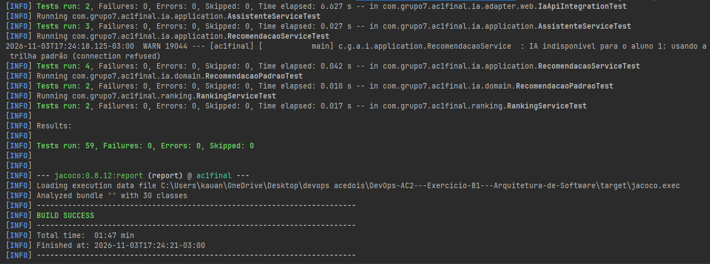

**Mini-lab com Docker:** o script [`labs/desafio-3/lab-ia.ps1`](../../labs/desafio-3/lab-ia.ps1) roda 3 cenários e confere 9 verificações. O resultado está em [`evidencias/desafio-3/lab-resultado.txt`](evidencias/desafio-3/lab-resultado.txt).

| Cenário | Resultado esperado |
|---|---|
| 1. IA no ar | Recomendação com `origem=IA`; assistente responde 200 |
| 2. `docker compose stop ia-service` | Recomendação com 200 e `origem=PADRAO` em menos de 2 s; assistente 503; `concluir-curso` 200 |
| 3. IA lenta (`IA_ATRASO_MS=3000`) | Recomendação com `origem=PADRAO` em cerca de 0,8 s (timeout); assistente 200, porque o timeout dele é de 5 s |

**Como reproduzir**
```bash
./mvnw test -Dtest="IaHttpClientTest,IaApiIntegrationTest,ArquiteturaIaTest"
cd ia-service && pip install -r requirements-dev.txt && pytest
powershell -ExecutionPolicy Bypass -File labs/desafio-3/lab-ia.ps1
```

## 3.8 ADR-003 — Serviço Python independente para a IA

- **Status:** Aceito (2026-11-03).
- **Contexto:** a plataforma ganha recomendação (RF03) e assistente (RF04). Os modelos são em Python, têm ciclo de atualização próprio e carga variável. A IA pode cair, mas o fluxo essencial do Core não pode cair junto.
- **ASRs / RPCs:** ASR-06, ASR-07, ASR-08 · RPC-01, RPC-06, RPC-07.
- **Alternativas:** (A) IA embutida no Core; (B) módulo acoplado; (C) serviço Python independente; e, dentro de (C), ML e RAG juntos ou separados. A comparação está em 3.6.
- **Decisão:** adotar **(C1)**, um `ia-service` em FastAPI com ML e RAG em módulos separados. No Core:
  - um módulo `ia` com duas portas de saída (`RecomendacaoIaPort` e `AssistenteIaPort`), implementadas por um adapter HTTP;
  - timeouts de conexão de 300 ms e de leitura de 800 ms (recomendação) e 5 s (assistente);
  - fallback da recomendação para a trilha padrão (`origem=PADRAO`) e 503 explícito para o assistente.

  O `ia-service` não acessa o banco do Core: o Core envia o contexto (plano e cursos concluídos) em cada chamada. O backend não declara `depends_on` para a IA.
- **Consequências:**
  - (+) Modelos evoluem e escalam sem tocar no Core.
  - (+) A IA fora do ar custa no máximo um timeout, e só nas telas de IA.
  - (+) Trocar o simulado por um modelo real ou por um LLM não muda o Core.
  - (−) Não há circuit breaker: com a IA lenta, cada requisição de recomendação paga até 800 ms.
  - (−) O contrato fica em dois lados (Pydantic e records Java). Isso é mitigado por testes de contrato nos dois lados e por um leitor tolerante.
  - (−) Mais um container e mais um pipeline (D6).
- **Revisitar quando:**
  - o assistente passar a usar um LLM real: separar em dois serviços (C2);
  - as métricas do D6 mostrarem muitas chamadas pagando timeout: adicionar circuit breaker (Resilience4j);
  - a recomendação precisar de histórico de eventos: consumir os eventos do D4 em vez de receber o contexto na chamada.

## 3.9 C4 — Container (fronteira da IA e protocolos)

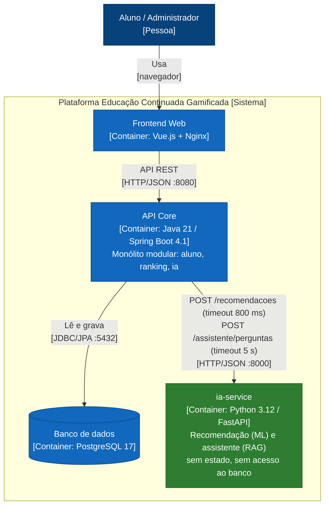

---

# Desafio 4 — Comunicação e eventos

**Pergunta:** onde o sincronismo é necessário e onde eventos reduzem o acoplamento? Ao concluir um curso, o sistema registra a conclusão, calcula as recompensas e pode disparar notificação e analytics. A notificação falhar não pode impedir a conclusão.

## 4.1 RF

- **RF02 Conquistas:** a conclusão do 12º curso promove o aluno a PREMIUM, com voucher (US 2).
- **RF05 Notificações:** o aluno é avisado da promoção (US 3). Antes era um `PUT /notificar` que o frontend chamava na mão; agora a notificação reage ao evento `AlunoPromovidoPremium`.
- **Eventos associados à conclusão de atividades:** o evento fica disponível para novos consumidores, como analytics, sem mudar o Core.

## 4.2 RNF analisados (FURPS+)

| RNF | FURPS+ | Leitura no cenário | Vira ASR? |
|---|---|---|---|
| Tolerância a falhas / disponibilidade | R | O consumidor externo (notificação) ou o broker podem cair | **Sim → ASR-09** |
| Recuperabilidade | R | Uma promoção não pode ficar sem notificação depois que a falha passa | **Sim → ASR-10** |
| Consistência | R (integridade) | Conclusão e recompensa não podem divergir; a notificação pode chegar depois | **Sim → ASR-11** |
| Latência | P | Com o consumidor no ar, as duas formas respondem rápido (mini-lab, 12º curso: 261 ms e 37 ms nos cenários assíncronos, 38 ms no síncrono) | Não: no caminho feliz a diferença é pequena e varia entre execuções; o que muda é o comportamento sob falha |
| Desacoplamento | S | O Core não deveria conhecer cada consumidor | Não: é o efeito da decisão, verificado pela regra ArchUnit |

## 4.3 ASRs selecionados (máx. 3)

1. **ASR-09 Disponibilidade do fluxo essencial.** Altera a **comunicação**: a notificação sai do caminho síncrono da conclusão de curso.
2. **ASR-10 Recuperabilidade.** Altera **dados e operação**: o evento fica guardado de forma durável (outbox no banco e fila durável no broker) e é entregue quando a falha passa, pelo menos uma vez.
3. **ASR-11 Consistência.** Altera os **dados**: a conclusão, a recompensa e o registro do evento acontecem na **mesma transação**; só a entrega é eventual.

## 4.4 RPCs aplicáveis

- **RPC-08:** as operações essenciais do Core devem concluir mesmo com um consumidor externo indisponível.
- **RPC-09:** adotar um broker tem custo operacional (mais um container para operar, monitorar e atualizar).
- RPC-02 (equipe de 6) e RPC-05 (Docker Compose) continuam valendo e pesam contra soluções mais pesadas.

## 4.5 Decisão do Tech Lead

- **Qual resposta precisa ser imediata?** A conclusão do curso e a recompensa (PREMIUM e voucher): o aluno sai da requisição vendo o plano novo.
- **Qual pode ser eventual?** A notificação da promoção, entregue em segundos, e qualquer consumidor futuro (analytics, ranking em cache).
- **Que ASR justifica mensageria?** O ASR-10, somado ao fato de o consumidor ser **outro processo**. Um evento interno do Spring (`@Async`) tira a notificação do caminho, mas perde o evento se a aplicação cair e não alcança outro serviço. Fazer retry de HTTP dentro do Core seria reimplementar uma fila. O broker entrega durabilidade, reentrega e desacoplamento prontos.
- **RabbitMQ ou Kafka resolvem um problema real?** O RabbitMQ resolve o nosso: uma fila de trabalho com confirmação por mensagem, durável, com reentrega e roteamento por tópico, num container leve. O Kafka resolve outro problema (log retido para replay, alta vazão, muitos grupos de consumidores), com custo operacional maior (RPC-09) para um fluxo de poucos eventos e um consumidor só. Fica como gatilho, caso o analytics precise reprocessar o histórico.
- **E se o próprio broker cair?** Gravar no banco e publicar no broker não é uma operação atômica: é o problema do *dual write*. Por isso o evento é gravado numa tabela **outbox** na mesma transação da conclusão, e um relay publica no RabbitMQ depois. Com o broker fora, o evento espera no banco.

## 4.6 Alternativas e trade-offs

| | (A) REST síncrono | (B) Evento interno do Spring | **(C) RabbitMQ + outbox** | (D) Kafka + outbox |
|---|---|---|---|---|
| Como fica | O Core chama `POST /notificacoes` dentro da conclusão | `@TransactionalEventListener` + `@Async` no próprio Core | Evento no outbox (mesma transação) → relay → fila durável → `notificacao-service` | Igual a (C), com tópico Kafka |
| Ganha | Simples; o aluno sai notificado | Sem broker; a resposta não espera a notificação | A conclusão nunca falha pela notificação; nada se perde; consumidores independentes | Replay, alta vazão, vários grupos de consumidores |
| Perde | Consumidor fora = conclusão desfeita (503) | Evento só em memória: perdido se o Core cair; não chega a outro processo | +1 broker para operar; entrega pelo menos uma vez (consumidor idempotente); notificação eventual | Cluster mais pesado; sem necessidade de replay hoje (RPC-09) |
| ASR-09 / 10 / 11 | ✗ / ✓ / ✓ | ✓ / ✗ / parcial | ✓ / ✓ / ✓ | ✓ / ✓ / ✓ |
| Veredito | Rejeitada; mantida só para o mini-lab comparar | Rejeitada | **Escolhida** | Adiada (gatilho no ADR-004) |

## 4.7 Evidência (mini-lab)

**Hipótese:** com a notificação fora do caminho síncrono e o evento gravado no outbox, a conclusão de curso responde 200 com o consumidor ou o broker indisponíveis, e a notificação chega quando a falha passa. No modo síncrono, a mesma falha desfaz a conclusão.

**Testes automatizados (`./mvnw test` e `pytest`)**

| Teste | O que prova |
|---|---|
| [`PromocaoPremiumTest`](../../src/test/java/com/grupo7/ac1final/aluno/application/PromocaoPremiumTest.java) | Exatamente um evento no 12º curso, e nenhum para quem já era PREMIUM; no modo assíncrono, promove na hora e só marca "notificado" depois; no síncrono, marca na hora; a falha do notificador síncrono propaga, para desfazer a transação |
| [`NotificacaoAssincronaIntegrationTest`](../../src/test/java/com/grupo7/ac1final/aluno/adapter/web/NotificacaoAssincronaIntegrationTest.java) | Spring + H2, sem broker nem consumidor: 13 conclusões com 200, PREMIUM imediato, um único evento no outbox; o `PUT /notificar` do consumidor fecha o ciclo |
| [`NotificacaoSincronaIntegrationTest`](../../src/test/java/com/grupo7/ac1final/aluno/adapter/http/NotificacaoSincronaIntegrationTest.java) | Alternativa (A): com a notificação fora, o 12º curso responde 503 e o aluno continua com 11 cursos e BASICO; com ela de volta, passa e já sai notificado |
| `OutboxJpaTest`, `OutboxNotificadorPromocaoTest` | Outbox real (JPA): o evento fica pendente até ser publicado e as tentativas que falham são contadas; a mensagem segue o contrato JSON do consumidor |
| [`ArquiteturaEventosTest`](../../src/test/java/com/grupo7/ac1final/arquitetura/ArquiteturaEventosTest.java) | A aplicação não conhece broker nem HTTP; só `aluno.adapter.mensageria` conhece o RabbitMQ; o evento de domínio é Java puro |
| [`notificacao-service/tests`](../../notificacao-service/tests) (pytest, 10 testes) | Notificação idempotente por `eventoId`; com o Core fora, a mensagem volta para a fila; mensagem inválida é descartada; topologia igual à do Core |

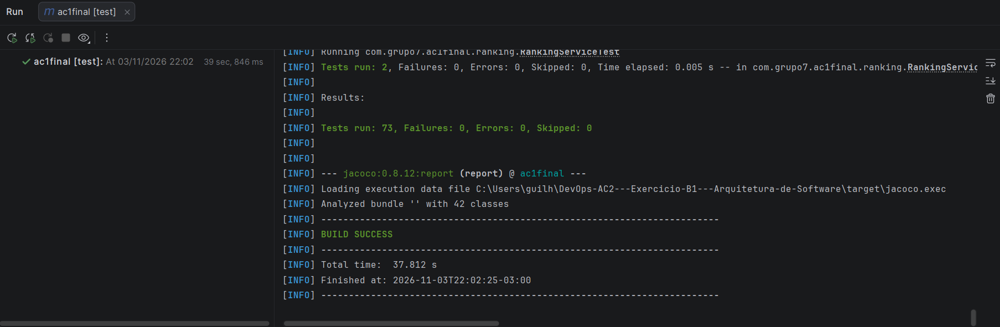

**Mini-lab com Docker:** o script [`labs/desafio-4/lab-eventos.ps1`](../../labs/desafio-4/lab-eventos.ps1) roda 3 cenários e confere 13 verificações. Resultado: **13 de 13**, em [`evidencias/desafio-4/lab-resultado.txt`](evidencias/desafio-4/lab-resultado.txt).

| Cenário | Resultado obtido |
|---|---|
| 1. Assíncrono, `docker compose stop notificacao-service` | 12 conclusões com 200; PREMIUM e voucher na hora; `notificado=false`; 1 mensagem esperando na fila; ao religar o consumidor, notificado em 1,1 s, com uma notificação só |
| 2. Assíncrono, `docker compose stop rabbitmq` | 12 conclusões com 200; 1 evento pendente no outbox; ao religar o broker, o relay publicou, o consumidor entregou em 5,2 s e o outbox esvaziou |
| 3. Síncrono (`NOTIFICACAO_MODO=sincrono`), consumidor fora | 12º curso com **503 em 2610 ms**, e a conclusão foi desfeita (11 cursos, BASICO); com o consumidor de volta, passou (200 em 38 ms) e já saiu notificado |

**Sobre os tempos de entrega:** os 5,2 s do cenário 2 incluem a subida do broker, a reconexão do consumidor (que tenta a cada 3 s) e o intervalo do relay (2 s). No cenário 1, o broker já estava no ar e a mensagem chegou assim que o consumidor reconectou.

**Observação do cenário 3:** depois de o `notificacao-service` voltar a responder, o Core ainda recusou a conclusão por **8,1 s (5 tentativas)**. A JVM guarda por cerca de 10 s a falha de DNS do nome do serviço (cache negativo), então o modo síncrono continua falhando por um tempo mesmo depois de a dependência voltar. No modo assíncrono, essa janela não chega ao aluno.

**Como reproduzir**
```bash
./mvnw test -Dtest="PromocaoPremiumTest,Notificacao*IntegrationTest,OutboxJpaTest,ArquiteturaEventosTest"
cd notificacao-service && pip install -r requirements-dev.txt && pytest
powershell -ExecutionPolicy Bypass -File labs/desafio-4/lab-eventos.ps1
```

## 4.8 ADR-004 — Notificação assíncrona com RabbitMQ e outbox transacional

- **Status:** Aceito (2026-11-03).
- **Contexto:** a promoção para PREMIUM precisa disparar a notificação da US 3, que antes dependia de uma chamada manual. A conclusão do curso é a operação essencial e não pode falhar por causa de um consumidor externo (RPC-08).
- **ASRs / RPCs:** ASR-09, ASR-10, ASR-11 · RPC-08, RPC-09.
- **Alternativas:** (A) REST síncrono; (B) evento interno do Spring; (C) RabbitMQ + outbox; (D) Kafka + outbox. A comparação está em 4.6.
- **Decisão:** adotar **(C)**.
  - O domínio emite o fato `AlunoPromovidoPremium`, com um `eventoId` único.
  - O caso de uso entrega o evento à porta `NotificadorPromocao`. O adapter padrão grava o evento na tabela `outbox_eventos`, na mesma transação da conclusão.
  - O `OutboxRelay` publica a cada 2 s na exchange `gamificacao.eventos` (rota `aluno.promovido-premium`), que leva à fila durável `notificacao.aluno-promovido`, com mensagens persistentes (padrão do Spring AMQP).
  - O `notificacao-service` (Python) consome, notifica de forma idempotente por `eventoId`, avisa o Core por `PUT /alunos/{id}/notificar` e só então confirma a mensagem (`ack`).
  - O backend não declara `depends_on` nem para o broker nem para o consumidor.
  - A alternativa (A) fica disponível só por configuração (`NOTIFICACAO_MODO=sincrono`), para o mini-lab.
- **Consequências:**
  - (+) A conclusão de curso não depende de nada fora do Core e do banco. No mini-lab, as 24 conclusões dos cenários 1 e 2 responderam 200, enquanto a alternativa (A) devolveu 503 e ainda levou 8,1 s para se recuperar depois de o serviço voltar.
  - (+) Nenhuma promoção fica sem notificação: o evento espera no outbox ou na fila.
  - (+) Novos consumidores (analytics) assinam a exchange sem mudar o Core.
  - (−) A notificação é eventual: chega segundos depois, não na mesma resposta.
  - (−) A entrega é "pelo menos uma vez", então todo consumidor precisa ser idempotente.
  - (−) Mais um container para operar (RPC-09), uma tabela a mais e um relay por polling (até 2 s de atraso).
  - (−) Sem *publisher confirms* nem fila de mensagens mortas (DLQ): uma mensagem inválida é descartada pelo consumidor.
- **Revisitar quando:**
  - o analytics precisar reprocessar o histórico de eventos: avaliar Kafka (D);
  - o volume de eventos tornar o polling caro: avaliar CDC (Debezium);
  - o D6 mostrar mensagens descartadas: adicionar DLQ e *publisher confirms*.

## 4.9 C4 — Container e sequência do fluxo crítico

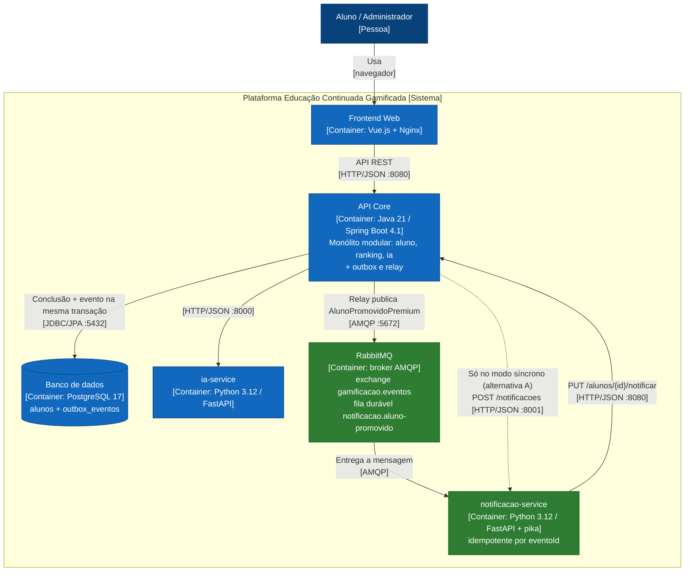

**Sequência do fluxo crítico** (12º curso, modo assíncrono):

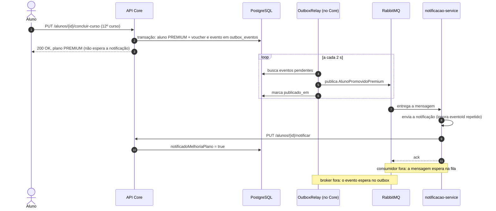

---

# Desafio 5 — IoT e MQTT

**Pergunta:** como receber eventos de dispositivos com pouco recurso e conexão instável sem transformar o Core num acoplamento direto com cada dispositivo? Os laboratórios passam a produzir eventos de presença, de início e de conclusão de atividade.

## 5.1 RF

- **RF06 Eventos IoT:** receber os eventos dos laboratórios e encaminhá-los ao ecossistema da plataforma.
  - A **conclusão de atividade** soma um curso pelas mesmas regras do `PUT /concluir-curso`: 12 cursos dão PREMIUM com voucher, e a promoção segue o fluxo de eventos do D4 até a notificação.
  - **Presença** e **início de atividade** ficam registrados (`GET /iot/eventos?alunoId=`) para frequência e analytics, sem mudar o progresso.

## 5.2 RNF analisados (FURPS+)

| RNF | FURPS+ | Leitura no cenário | Vira ASR? |
|---|---|---|---|
| Tolerância à conectividade intermitente | R | O aparelho perde a rede e reenvia; o QoS 1 entrega "pelo menos uma vez", então chegam duplicatas | **Sim → ASR-12** |
| Eficiência de comunicação | P | Dispositivos com pouca CPU, memória, bateria e banda | **Sim → ASR-13** |
| Interoperabilidade | S | Cada fabricante tem o seu formato; o Core não pode conhecer todos | **Sim → ASR-14** |
| Disponibilidade | R | O laboratório não pode depender do Core estar no ar | Não vira ASR próprio: é coberta pelo ASR-12 (o broker guarda e o gateway tenta de novo) |
| Escalabilidade | P | Mais laboratórios e mais aparelhos | Não agora: um broker e um gateway atendem a carga do lab; o gateway não tem estado e pode ganhar réplicas |
| Segurança de integração | S | Os dispositivos ficam na rede do laboratório | Não vira ASR no lab: entra nas consequências (usuário por dispositivo, ACL por tópico, TLS) |

## 5.3 ASRs selecionados (máx. 3)

1. **ASR-12 Tolerância à conectividade intermitente.** Com o dispositivo, o gateway ou o Core fora do ar, nenhum evento se perde e nenhum conta duas vezes. Altera a **comunicação** (QoS 1 e sessão persistente) e os **dados** (deduplicação por `eventoId` na mesma transação, com `UNIQUE` no banco).
2. **ASR-13 Eficiência de comunicação.** O dispositivo publica um evento em poucas dezenas de bytes, numa conexão que fica aberta, sem uma requisição HTTP por evento. Altera a **comunicação** (protocolo MQTT e payload compacto).
3. **ASR-14 Interoperabilidade.** O Core não conhece dispositivos nem MQTT: um formato novo de aparelho muda só o tradutor do gateway. Altera a **estrutura** (um gateway tradutor entre a borda e o Core).

## 5.4 RPCs aplicáveis

- **RPC-10:** os dispositivos têm baixo poder computacional.
- **RPC-11:** a conectividade dos laboratórios é intermitente.
- **RPC-12:** o protocolo e o broker adicionam componentes para operar.
- RPC-02 (equipe de 6), RPC-05 (Docker Compose) e RPC-09 (custo de um broker, D4) continuam valendo.

## 5.5 Decisão do Tech Lead

- **REST é suficiente?** Entre o gateway e o Core, sim: o Core recebe `POST /iot/eventos` como qualquer outra chamada. Entre o dispositivo e a plataforma, não. Cada evento seria uma conexão HTTP com cabeçalhos maiores que o próprio dado; sem rede, o aparelho teria de implementar fila e retentativa sozinho; e, com o Core fora, ou o evento se perde ou o dispositivo fica preso esperando.
- **O que o MQTT resolve especificamente?**
  - conexão persistente e leve, com cabeçalho fixo de 2 bytes (no lab, cada evento ocupou **71 bytes** de payload);
  - QoS 1: o broker confirma o recebimento, e o aparelho reenvia se não houver confirmação;
  - sessão persistente: o broker guarda as mensagens do assinante que caiu (no lab, o `iot-gateway`) e entrega quando ele volta;
  - tópicos por laboratório e dispositivo (`labs/{lab}/dispositivos/{disp}/eventos`): os aparelhos não conhecem quem consome.
- **Depois do MQTT, existe motivo arquitetural para outro broker?** Não, hoje não. O evento IoT tem um único consumidor (o Core, pelo gateway), e o efeito que interessa ao resto da plataforma (conclusão → promoção) **já chega ao RabbitMQ** pelo outbox do D4, sem nada novo. Ligar o MQTT à mensageria interna (alternativa C) só se justifica quando outros consumidores precisarem dos eventos crus, como analytics de presença. Também não usamos o RabbitMQ como broker MQTT (plugin `rabbitmq_mqtt`): manter a borda dos dispositivos num broker próprio separa o tráfego e a superfície de ataque da mensageria interna, ao custo de um container leve a mais (RPC-12).
- **Como impedir duplicidade ou perda relevante de eventos?**
  - **Perda:** QoS 1 do dispositivo até o broker; sessão persistente (`clean_session=false`, `client_id` fixo) do broker até o gateway; o gateway só confirma a mensagem (PUBACK) **depois** que o Core respondeu; com o Core fora, o gateway espera e tenta de novo (1, 2, 4... até 10 s).
  - **Duplicidade:** o `eventoId` é gerado **no dispositivo**, então uma retransmissão chega com o mesmo id. O Core grava o `eventoId` **na mesma transação** em que soma o curso, e a coluna é `UNIQUE`. A repetição responde 200 `DUPLICADO` e não muda nada.
  - **Por que não QoS 2:** ele garante "exatamente uma vez" só entre um cliente e o broker, não até o banco do Core, e custa 4 pacotes por mensagem num aparelho fraco. QoS 1 com idempotência no Core protege o caminho inteiro por menos.

## 5.6 Alternativas e trade-offs

| | (A) REST direto do dispositivo | **(B) MQTT + gateway consumidor** | (C) MQTT + mensageria interna |
|---|---|---|---|
| Como fica | Cada aparelho chama `POST` no Core | Aparelhos publicam no Mosquitto; o `iot-gateway` assina, traduz e chama `POST /iot/eventos` | O gateway (ou uma ponte MQTT → AMQP) publica os eventos crus no RabbitMQ, e o Core consome |
| Ganha | Simples, sem broker | Conexão leve, QoS 1 e sessão persistente; o Core não conhece MQTT; um formato novo é só um tradutor novo | Vários consumidores dos eventos crus (analytics, frequência) |
| Perde | Core acoplado a cada aparelho e formato; HTTP pesado; o dispositivo precisa de fila e retentativa; Core fora = evento perdido ou aparelho bloqueado | +1 broker e +1 serviço para operar (RPC-12); entrega "pelo menos uma vez" exige deduplicação | Dois brokers e mais um salto sem ASR que peça; o efeito relevante já chega ao RabbitMQ pelo outbox do D4 |
| ASR-12 / 13 / 14 | ✗ / ✗ / ✗ | ✓ / ✓ / ✓ | ✓ / ✓ / ✓ (mais caro) |
| Veredito | Rejeitada | **Escolhida** | Adiada (gatilho no ADR-005) |

## 5.7 Evidência (mini-lab)

**Hipótese:** com MQTT (QoS 1 e sessão persistente), um gateway tradutor e deduplicação por `eventoId` no Core, os eventos do laboratório chegam ao Core mesmo com o dispositivo, o gateway ou o Core fora do ar, e uma retransmissão nunca conta duas vezes.

**Testes automatizados**

| Teste | O que prova |
|---|---|
| [`RegistroEventoIotServiceTest`](../../src/test/java/com/grupo7/ac1final/iot/application/RegistroEventoIotServiceTest.java), [`EventoIotTest`](../../src/test/java/com/grupo7/ac1final/iot/domain/EventoIotTest.java) | Sem Spring: a mesma conclusão 3 vezes soma 1 curso; presença e início não somam; aluno inexistente não é registrado; evento incompleto é recusado |
| [`EventoIotApiIntegrationTest`](../../src/test/java/com/grupo7/ac1final/iot/adapter/web/EventoIotApiIntegrationTest.java) | Core completo (Spring + H2): 201 `REGISTRADO` e depois 200 `DUPLICADO`; 12 conclusões vindas do laboratório viram PREMIUM; aluno inexistente dá 404 e evento inválido dá 400 |
| [`ArquiteturaIotTest`](../../src/test/java/com/grupo7/ac1final/arquitetura/ArquiteturaIotTest.java) + regra nova em `ArquiteturaModularTest` | Nenhuma classe do Core conhece MQTT; o domínio `iot` é Java puro; o `iot` só usa `aluno.api` |
| [`iot-gateway/tests`](../../iot-gateway/tests) (pytest, 21 testes) | Tradução do formato compacto; com o Core fora, o gateway espera e tenta de novo; mensagem inválida é descartada; contrato HTTP com o Core; payload abaixo de 80 bytes |

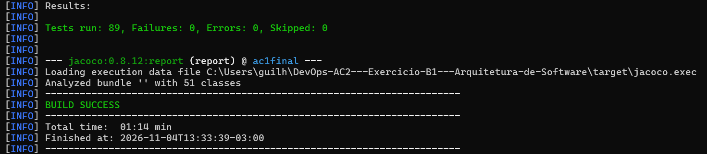

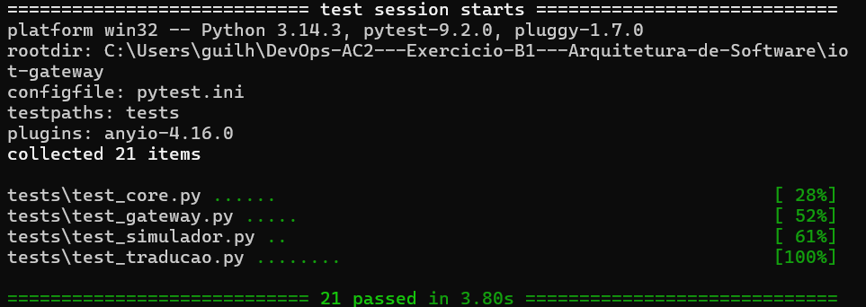

**Mini-lab com Docker:** o script [`labs/desafio-5/lab-iot.ps1`](../../labs/desafio-5/lab-iot.ps1) usa o simulador de dispositivo e confere 10 verificações. Resultado: **10 de 10**, em [`evidencias/desafio-5/lab-resultado.txt`](evidencias/desafio-5/lab-resultado.txt). O [log do gateway](evidencias/desafio-5/iot-gateway-log.txt) mostra cada evento como `REGISTRADO`, `DUPLICADO` ou "nova tentativa".

| Cenário | Resultado obtido |
|---|---|
| 1. Fluxo normal | Presença, início e conclusão chegaram ao Core em 0,1 s; só a conclusão somou curso; **71 bytes** por evento |
| 2. A mesma conclusão enviada 3 vezes | Somou **1** curso; as 2 repetições voltaram como `DUPLICADO` |
| 3. Dispositivo offline com 10 conclusões guardadas | As 10 chegaram ao reconectar; o aluno foi a 12 cursos, PREMIUM e voucher; a notificação do D4 foi entregue (`notificado=true`) |
| 4. `docker compose stop iot-gateway` + 3 conclusões | Com o gateway fora, nada chegou ao Core; ao religar, as 3 mensagens guardadas no broker chegaram em 1,1 s |
| 5. `docker compose stop backend` + 1 conclusão | O gateway registrou "nova tentativa"; com o Core de volta, o evento foi entregue em 1,1 s |

**Como reproduzir**
```bash
./mvnw test -Dtest="EventoIotTest,RegistroEventoIotServiceTest,EventoIotApiIntegrationTest,ArquiteturaIotTest"
cd iot-gateway && pip install -r requirements-dev.txt && pytest
powershell -ExecutionPolicy Bypass -File labs/desafio-5/lab-iot.ps1
docker compose run --rm iot-simulador --aluno 1 --presenca --conclusoes 1    # simulador avulso
```

## 5.8 ADR-005 — Eventos IoT por MQTT, com gateway tradutor e deduplicação no Core

- **Status:** Aceito (2026-11-04).
- **Contexto:** os laboratórios passam a produzir eventos de presença, início e conclusão de atividade em dispositivos com pouco recurso e conexão instável. O Core não pode se acoplar a cada dispositivo, e um evento repetido não pode somar curso duas vezes.
- **ASRs / RPCs:** ASR-12, ASR-13, ASR-14 · RPC-10, RPC-11, RPC-12.
- **Alternativas:** (A) REST direto do dispositivo; (B) MQTT + gateway consumidor; (C) MQTT + integração com a mensageria interna. A comparação está em 5.6.
- **Decisão:** adotar **(B)**.
  - Os dispositivos publicam com QoS 1 no **Mosquitto**, no tópico `labs/{lab}/dispositivos/{disp}/eventos`, com payload compacto (`{"id","a","t","ts"}`) e o `eventoId` gerado no próprio aparelho.
  - O **`iot-gateway`** (Python, paho-mqtt) assina `labs/+/dispositivos/+/eventos` com sessão persistente, traduz para o formato da plataforma e chama `POST /iot/eventos`. Ele só confirma a mensagem depois da resposta do Core e tenta de novo quando o Core está fora.
  - No Core, o módulo **`iot`** registra o `eventoId` na mesma transação em que conclui o curso, pela API pública `ConclusaoDeCurso` do aluno, com `UNIQUE` em `eventos_iot.evento_id`.
  - O backend não declara `depends_on` nem para o broker nem para o gateway.
  - O `iot-gateway` ganhou caminho próprio na esteira do D6: testes → imagem → smoke da imagem.
- **Consequências:**
  - (+) O Core não conhece MQTT nem o formato dos aparelhos (regra ArchUnit); um fabricante novo muda só o tradutor.
  - (+) Nenhum evento se perdeu com o dispositivo, o gateway ou o Core fora, e nenhum contou duas vezes (lab: 10 de 10).
  - (+) A conclusão vinda do laboratório segue as mesmas regras e o mesmo fluxo de eventos do D4, sem código novo para promoção e notificação.
  - (−) Mais dois componentes para operar (broker e gateway, RPC-12).
  - (−) Com o Core fora, o gateway segura **uma** mensagem por vez enquanto tenta de novo: as outras esperam no broker. Se a espera passar do keepalive, o broker reentrega, e o Core descarta a repetição.
  - (−) Só no laboratório: broker sem usuário nem TLS (`allow_anonymous true`), um único gateway e o simulador rodando na mesma imagem do gateway.
  - (−) Os eventos crus (presença, início) ficam só na tabela do Core; ninguém mais os consome.
  - (−) Na esteira, o gateway não tem homologação de verdade (precisaria de um broker), só o smoke da imagem.
- **Revisitar quando:**
  - outros consumidores precisarem dos eventos crus (analytics de presença): ligar o MQTT ao RabbitMQ (C) ou publicar a partir do Core;
  - houver aparelhos em rede aberta: usuário por dispositivo, ACL por tópico e TLS (porta 8883);
  - o volume de laboratórios crescer: réplicas do gateway com *shared subscriptions* (`$share/...`) e métricas de eventos duplicados no Prometheus (ADR-006).

## 5.9 C4 — Container (borda IoT) e sequência

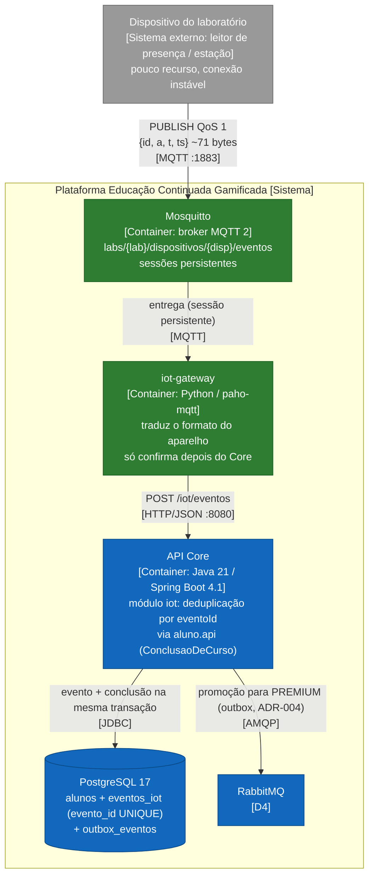

**Sequência:** dispositivo que ficou offline e retransmite.

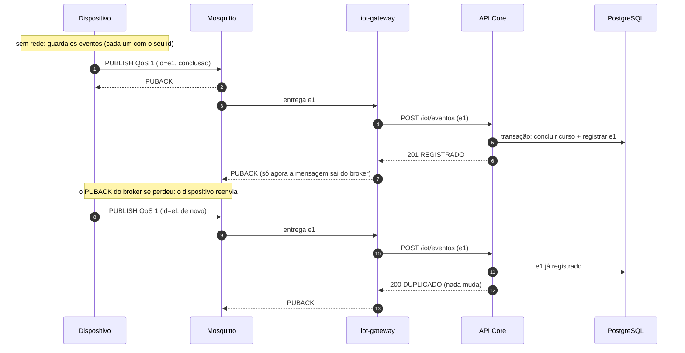

---

# Desafio 6 — CI/CD e observabilidade

**Pergunta:** a arquitetura pode ser construída, implantada e observada com segurança? Depois dos D1 a D4, a solução tem um Core Java, dois serviços Python, um broker e um banco. Ela só se sustenta se a equipe conseguir testar, implantar e observar cada parte, e se cada decisão anterior puder ser verificada em funcionamento, não só no papel.

Um motivo concreto: no meio do B1, um commit enviado direto para a `main` deixou o projeto sem compilar, e nada impediu isso. A esteira deste desafio barra esse tipo de commit no primeiro estágio.

## 6.1 RF

- **Todos os RFs já construídos** (RF01 ranking, RF02 conquistas, RF03 e RF04 IA, RF05 notificações): cada um precisa ser testado e implantado sem quebrar os outros. O RF06 (IoT, D5) também: o `iot-gateway` ganhou caminho próprio na esteira.
- **Operação e evolução da solução:** saber, em funcionamento, se as decisões dos ADRs 001 a 004 estão se sustentando.

## 6.2 RNF analisados (FURPS+)

| RNF | FURPS+ | Leitura no cenário | Vira ASR? |
|---|---|---|---|
| Observabilidade | S (operação) | Sem métricas, não dá para saber se a IA caiu para a trilha padrão ou se há eventos parados | **Sim → ASR-15** |
| Deploy independente | S (implantação) | Core, `ia-service` e `notificacao-service` mudam em ritmos diferentes | **Sim → ASR-16** |
| Confiabilidade da entrega / testabilidade | R / S | Um commit que viola um ADR ou não compila não pode chegar a um ambiente | **Sim → ASR-17** |
| Recuperabilidade | R | Já é o ASR-10 (D4) | Não: aqui ela passa a ser **medida** (outbox e fila voltando a 0) |
| Desempenho | P | Latência da conclusão de curso e do ranking | Não vira ASR novo: passa a ser medido (p95 por rota) e alimenta o ASR-02 |

## 6.3 ASRs selecionados (máx. 3)

1. **ASR-15 Observabilidade.** Cada decisão arquitetural tem uma métrica que mostra, em funcionamento, se ela está se sustentando. Altera a **operação** (Prometheus e Grafana no ambiente) e a **estrutura** (as métricas ficam nos adapters, nunca no domínio).
2. **ASR-16 Deploy independente.** Um componente que mudou é testado, empacotado e implantado sem reconstruir nem reimplantar os que não mudaram, e a falha de um não bloqueia os outros. Altera a **implantação** (um caminho por componente, imagem com a tag do commit).
3. **ASR-17 Confiabilidade da entrega.** Nada chega à homologação sem passar nos testes, nas regras de arquitetura (ArchUnit) e no smoke test. Altera a **implantação** e a **operação** (barreiras na esteira).

## 6.4 RPCs aplicáveis

- **RPC-13:** o Jenkins é a base da esteira.
- **RPC-14:** Prometheus e Grafana são as ferramentas de observabilidade do laboratório.
- **RPC-15:** artefatos e configurações são versionados no repositório.
- RPC-02 (equipe de 6) e RPC-05 (Docker Compose) continuam valendo e pesam contra soluções com muitas peças para operar.

## 6.5 Decisão do Tech Lead

- **Serviços independentes exigem pipelines independentes?** Exigem **caminhos** independentes, não necessariamente pipelines separados. Com um monorepo, três componentes e uma equipe de 6, um único Jenkinsfile basta, desde que cada componente tenha o seu caminho, só rode quando o código dele mudar e possa falhar sem travar os outros (`failFast false`). Assim as barreiras ficam iguais para todos e são mantidas num lugar só.
- **O que deve bloquear o deploy?**
  - os testes do componente: no Core, os 76 testes, que incluem as **regras ArchUnit dos ADRs 001 a 004**; nos serviços Python, o pytest com os testes de contrato;
  - o build da imagem;
  - o smoke test na homologação (`/actuator/health` no Core, `/health` nos serviços Python).

  Não bloqueiam: a falha de outro componente, nem mudanças só em documentação.
- **Quais métricas validam ASRs anteriores?**

  | ASR / ADR | Métrica | Comportamento esperado |
  |---|---|---|
  | ASR-07 / ADR-003 | `gamificacao_recomendacoes_total{origem}` | IA fora: `PADRAO` sobe, e a recomendação continua com 200 |
  | ASR-09 / ADR-004 | `http_server_requests_seconds_count{uri="/alunos/{id}/concluir-curso",status}` | nenhuma conclusão com status diferente de 200 enquanto IA, broker ou consumidor estão fora |
  | ASR-10 / ADR-004 | `gamificacao_outbox_pendentes` e `rabbitmq_queue_messages_ready` | broker fora: o outbox sobe; consumidor fora: a fila sobe; os dois voltam a 0 sozinhos |
  | ASR-02 (desempenho) | `http_server_requests_seconds_bucket` (p95 por rota) | latência do fluxo essencial e do ranking acompanhada |
  | ASR-01, 04, 05 (estrutura) | não são métricas: são as regras ArchUnit, que rodam na esteira | um commit que viola um ADR é barrado |

- **Como distinguir métrica técnica de evidência arquitetural?** A métrica técnica descreve um componente: CPU, memória, latência, `up`. A evidência arquitetural é a **combinação** de uma hipótese de um ADR, uma condição provocada e as métricas que confirmam ou refutam a hipótese. Por exemplo, "`up{job="rabbitmq"} = 0` **e** a conclusão de curso continua com 200 **e** o outbox sobe e volta a 0" é a evidência de que o ADR-004 funciona. Cada uma dessas métricas, sozinha, é só técnica.
- **Coerência com o ADR-004:** o health do Core **não** considera o RabbitMQ (`management.health.rabbit.enabled=false`). O Core funciona sem o broker, então o broker fora não pode marcar o Core como DOWN. Se marcasse, um orquestrador reiniciaria o Core sem necessidade, recriando o acoplamento que o D4 eliminou.

## 6.6 Alternativas e trade-offs

**Esteira**

| | (A) Pipeline único sequencial | (B) Um pipeline por componente | **(C) Um Jenkinsfile, um caminho por componente** |
|---|---|---|---|
| Como fica | Tudo é testado e implantado a cada commit, em sequência | 3 Jenkinsfiles e 3 jobs, um por pasta | Um Jenkinsfile; cada caminho é ativado se a pasta do componente mudou desde o último build bem-sucedido; `failFast false` |
| Ganha | Simples de entender | Isolamento total; donos diferentes por componente | Deploy independente com as mesmas barreiras para todos, mantidas num lugar só |
| Perde | Qualquer mudança reconstrói e reimplanta tudo; uma falha bloqueia todos | 3 configurações para manter iguais; barreiras duplicadas; mais jobs para 6 pessoas operarem (RPC-02) | O mapa de pastas por componente precisa ser mantido; o Jenkinsfile fica maior |
| ASR-16 / 17 | ✗ / ✓ | ✓ / ✓ (com duplicação) | ✓ / ✓ |
| Veredito | Rejeitada | Adiada (gatilho no ADR-006) | **Escolhida** |

**Métricas**

| | Só métricas genéricas (JVM, CPU, `up`) | **Métricas ligadas aos ASRs** |
|---|---|---|
| Ganha | De graça, com o Actuator | Cada painel responde se um ADR está se sustentando |
| Perde | Não dizem se a IA degradou para a trilha padrão nem se há eventos parados | Cada métrica nova é um pouco de código num adapter |
| Veredito | Mantidas (já vêm com o Actuator), mas não bastam | **Escolhida** (latência, erros, disponibilidade e throughput da conclusão de curso, mais as 3 métricas de negócio) |

## 6.7 Evidência (mini-lab)

**Hipótese:** com a esteira em caminhos por componente, uma mudança só no `ia-service` implanta só o `ia-service`, e uma violação de ADR no Core bloqueia o deploy do Core sem afetar os outros. Com as métricas ligadas aos ASRs, as quedas da IA, do broker e do consumidor aparecem no Prometheus, enquanto a conclusão de curso continua com 200.

**Testes automatizados**

| Teste | O que prova |
|---|---|
| [`MetricasArquiteturaIntegrationTest`](../../src/test/java/com/grupo7/ac1final/observabilidade/MetricasArquiteturaIntegrationTest.java) | `/actuator/prometheus` expõe as métricas com a tag `application`; uma promoção ainda não publicada aparece no gauge do outbox; a queda da IA aparece como `origem=PADRAO` |

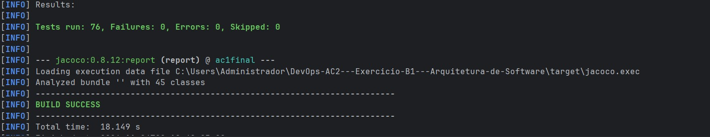

**Esteira no Jenkins** ([`Jenkinsfile`](../../Jenkinsfile), [`jenkins/casc.yaml`](../../jenkins/casc.yaml))

| Build | Branch | O que rodou | Resultado | Evidência |
|---|---|---|---|---|
| #1 | `feature/desafio-6` | os 3 caminhos (primeiro build) | tudo verde; os 3 componentes implantados na homologação (`ac1/*:7fcf5af`) | [print](evidencias/desafio-6/jenkins-build-completo.jpeg) |
| #4 | `lab/so-ia` (mudança só em `ia-service/`) | só o caminho do `ia-service`; Core e `notificacao-service` pulados | só o `ia-service` reimplantado | [print](evidencias/desafio-6/jenkins-so-ia.jpeg) |
| #5 | `lab/quebra-adr` (uma classe do `ranking` usando o domínio do aluno) | Core e `ia-service` | Core **barrado**: `rankingSoConheceAApiPublicaDoAluno` (ADR-001) violada, 76 testes com 1 falha; "Core: imagem" e "Core: homologação" *skipped due to earlier failure*; o `ia-service` foi implantado (smoke test OK em 2 s); a homologação do Core continuou em `ac1/core:75ecede` | [print](evidencias/desafio-6/jenkins-bloqueio-archunit.jpeg), [log](evidencias/desafio-6/jenkins-bloqueio-console.txt) |

Na primeira tentativa do cenário "só o `ia-service`" (build #2), os 3 caminhos rodaram. A causa: a detecção usava o `GIT_PREVIOUS_SUCCESSFUL_COMMIT` do Git, que é **por branch** e vem vazio numa branch nova. A detecção passou a comparar com o commit do **último build bem-sucedido do job** (commit `75ecede`); o build #3 rodou tudo uma vez como referência, e o build #4 mostrou o comportamento esperado.

**Observabilidade:** o script [`labs/desafio-6/lab-observabilidade.ps1`](../../labs/desafio-6/lab-observabilidade.ps1) derruba cada peça e confere a métrica **no Prometheus**. Resultado: **13 de 13**, em [`evidencias/desafio-6/lab-resultado.txt`](evidencias/desafio-6/lab-resultado.txt).

| Cenário | Medido no Prometheus |
|---|---|
| 1. `docker compose stop ia-service` | 10 recomendações com 200 e `origem=PADRAO`; `gamificacao_recomendacoes_total{origem="PADRAO"}` de 10 para 20; `concluir-curso` com 200 |
| 2. `docker compose stop rabbitmq` | `up{job="rabbitmq"} = 0` em 6 s; 12 conclusões com 200; `gamificacao_outbox_pendentes = 1`; ao religar, o outbox voltou a 0 em 16,1 s |
| 3. `docker compose stop notificacao-service` | 12 conclusões com 200; `rabbitmq_queue_messages_ready = 1`; ao religar, a fila voltou a 0 em 8,1 s |
| 4. Durante as 3 falhas | cerca de 50 conclusões de curso, **0** com status diferente de 200; **p95 = 10 ms** |

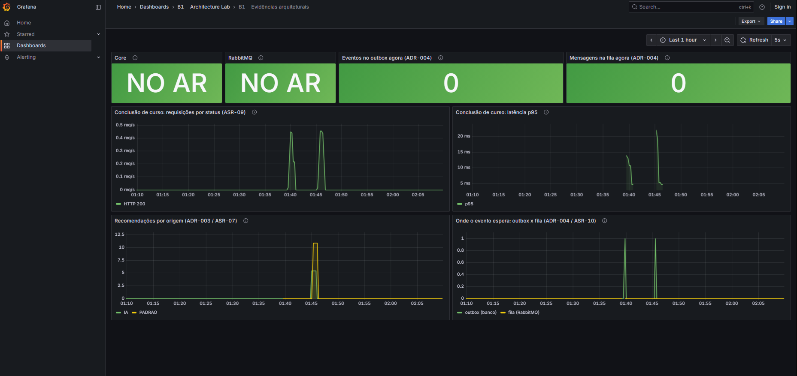

No print, os "morros" das 01:40 e das 01:45 são as duas execuções do lab. O pico da fila durou cerca de 8 s e quase não aparece na escala de 1 hora; o valor medido está no `lab-resultado.txt`.

**Como reproduzir**
```bash
docker compose up -d --build postgres rabbitmq notificacao-service ia-service backend prometheus grafana
powershell -ExecutionPolicy Bypass -File labs/desafio-6/lab-observabilidade.ps1
docker compose up -d --build jenkins     # http://localhost:8081 (admin/admin) → b1-esteira → Construir com parâmetros
```

## 6.8 ADR-006 — Esteira com caminhos por componente e métricas ligadas aos ASRs

- **Status:** Aceito (2026-11-04).
- **Contexto:** a solução tem três componentes implantáveis (Core, `ia-service` e `notificacao-service`), um broker e um banco, mantidos por uma equipe de 6 num único repositório. As decisões dos ADRs 001 a 004 precisam continuar valendo a cada commit e precisam ser verificáveis em funcionamento.
- **ASRs / RPCs:** ASR-15, ASR-16, ASR-17 · RPC-13, RPC-14, RPC-15.
- **Alternativas:** (A) pipeline único sequencial; (B) um pipeline por componente; (C) um Jenkinsfile com um caminho por componente. Para as métricas: só genéricas ou ligadas aos ASRs. A comparação está em 6.6.
- **Decisão:** adotar **(C)**, com métricas ligadas aos ASRs.
  - Um `Jenkinsfile` com três caminhos em paralelo: **testes → imagem (tag = commit) → homologação + smoke test**.
  - Cada caminho só roda se a pasta do componente mudou desde o último build bem-sucedido do job, e a falha de um não interrompe os outros (`failFast false`).
  - O Jenkins é configurado por arquivo (`jenkins/casc.yaml` e `plugins.txt`), sem assistente de instalação.
  - O Core expõe `/actuator/prometheus` com `gamificacao_outbox_pendentes`, `gamificacao_recomendacoes_total{origem}` e o histograma do `http.server.requests`.
  - O Prometheus coleta o Core e o RabbitMQ a cada 5 s, e o Grafana sobe com o dashboard versionado em `observabilidade/`.
- **Consequências:**
  - (+) Uma mudança num componente testa e implanta só ele (build #4).
  - (+) Uma violação de ADR nunca chega à homologação, e os outros componentes continuam sendo entregues (build #5).
  - (+) Cada ADR tem uma métrica em funcionamento, e as falhas do lab apareceram no Prometheus (13 de 13).
  - (+) Tudo é versionado: Jenkinsfile, configuração do Jenkins, plugins, `prometheus.yml`, datasource e dashboard.
  - (−) A detecção é por pastas: um arquivo comum fora do mapa (por exemplo, o `docker-compose.yaml`) não dispara nenhum caminho, e o mapa precisa ser atualizado quando surgir um componente novo, como foi feito com o `iot-gateway` no D5.
  - (−) Simplificações de laboratório: o Jenkins roda como root com acesso ao Docker da máquina (`docker.sock`), a senha `admin` fica no `casc.yaml`, e a imagem `jenkins/jenkins:lts-jdk21` e os plugins não têm versão fixa.
  - (−) Os serviços Python ainda não exportam métricas próprias (só `/health`), e não há alertas nem deploy de produção, só homologação.
  - (−) O p95 de 10 ms foi medido com a carga do lab (cerca de 50 requisições), não com 100 mil usuários. O ASR-02 continua parcial.
- **Revisitar quando:**
  - componentes passarem a ter times diferentes: separar os pipelines (B);
  - houver ambiente de produção: um estágio de deploy com aprovação manual (`input`) só na `main`;
  - o lab virar operação real: alertas no Prometheus para `gamificacao_outbox_pendentes > 0` por mais de 5 min e para `up == 0`, credenciais fora do repositório e agentes separados para o Jenkins;
  - houver muitos laboratórios: métricas de eventos IoT duplicados e de reentregas no Prometheus. (O `iot-gateway` já entrou no mapa de componentes no D5, com testes → imagem → smoke da imagem.)

## 6.9 C4 — Deployment e C4 final

**C4 Deployment** (ambiente do laboratório, uma máquina com Docker Desktop):

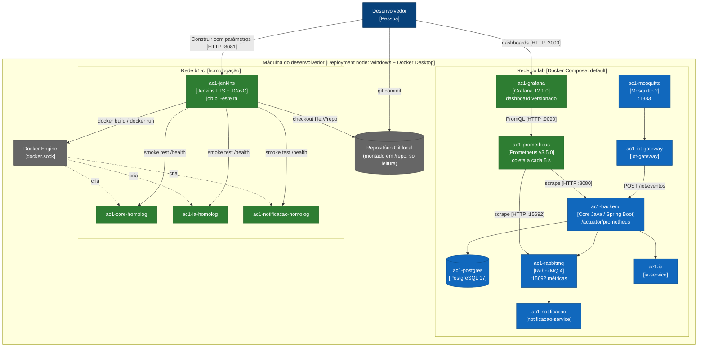

**C4 Container final do B1** (o que foi decidido nos ADRs 001 a 006):

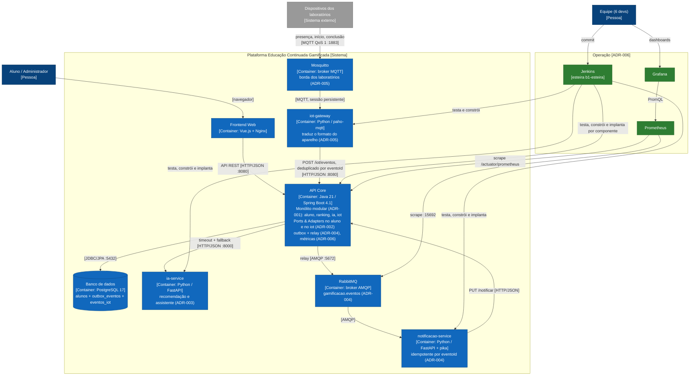

---

# Hipóteses herdadas da AC2

Todas as hipóteses que o registro da AC2 tinha antecipado sem o padrão completo foram decididas nos desafios 1 a 6, cada uma com ASRs, alternativas e evidência próprias.

# Histórico

- **AC2:** "Decisões Arquiteturais — Desafio 1" (substituído por este registro). Correção conceitual: aquele texto chamava de "monólito modular" a divisão `Domain/Service/Controller`, que é um monólito **em camadas**. A modularização por capacidade foi feita de fato no Desafio 1 do B1.
- **B1-D1** (2026-11-01): ADR-001, módulos `aluno` e `ranking`.
- **B1-D2** (2026-11-01): ADR-002, Ports & Adapters no módulo `aluno`. Suíte completa validada em 2026-11-02 (39 testes, 0 falhas).
- **B1-D3** (2026-11-03): ADR-003, `ia-service` (FastAPI) e módulo `ia` no Core com timeout e fallback.
- **B1-D4** (2026-11-03): ADR-004, notificação assíncrona com outbox, RabbitMQ e `notificacao-service`. Suíte completa com 73 testes, 0 falhas; mini-lab com 13 de 13 verificações.
- **B1-D5** (2026-11-04, concluído depois do D6): ADR-005, eventos IoT por MQTT (Mosquitto) com `iot-gateway` tradutor e deduplicação por `eventoId` no módulo `iot` do Core. Suíte com 89 testes, 0 falhas; pytest do gateway com 21; mini-lab com 10 de 10.
- **B1-D6** (2026-11-04): ADR-006, esteira Jenkins com um caminho por componente (Jenkinsfile + Configuration as Code), métricas no Prometheus e dashboard no Grafana. Suíte com 76 testes, 0 falhas; mini-lab com 13 de 13; deploy do Core bloqueado por uma violação do ADR-001 (build #5).
- **Repositórios:** a versão em camadas (AC1) permanece no repositório original. A versão modular (B1) está neste repositório, conforme orientação da professora.

# Síntese para a PoC da AF

Seguem para a PoC da Avaliação Final:

- **ADR-001:** monólito modular, com as fronteiras entre módulos testadas pelo ArchUnit a cada commit.
- **ADR-002:** domínio do aluno isolado por portas; regras testáveis sem Spring e sem banco.
- **ADR-003:** IA como serviço Python independente, com timeout e trilha padrão quando ela cai.
- **ADR-004:** eventos com outbox e RabbitMQ: o essencial nunca espera o periférico, e nada se perde.
- **ADR-006:** esteira com um caminho por componente e métricas ligadas aos ASRs: cada decisão é verificada a cada commit e observada em funcionamento.
- **ADR-005:** eventos IoT por MQTT, com um gateway tradutor na borda e deduplicação por `eventoId` no Core: o Core não conhece dispositivos, e nenhum evento se perde nem conta duas vezes.

Não seguem como estão, porque são decisões de laboratório ou alternativas adiadas:

- a alternativa síncrona do D4, que existe só para comparação no mini-lab;
- as simplificações do Jenkins (root com `docker.sock`, senha no repositório, versões sem fixar);
- Kafka (adiado no ADR-004) e pipelines separados por componente (adiados no ADR-006).

O que a PoC ainda precisa medir ou completar: carga no ranking com 100 mil usuários (ASR-02), escala do `ia-service` (ASR-08), alertas sobre as métricas do ADR-006 e segurança da borda IoT (usuário por dispositivo, ACL e TLS no broker).