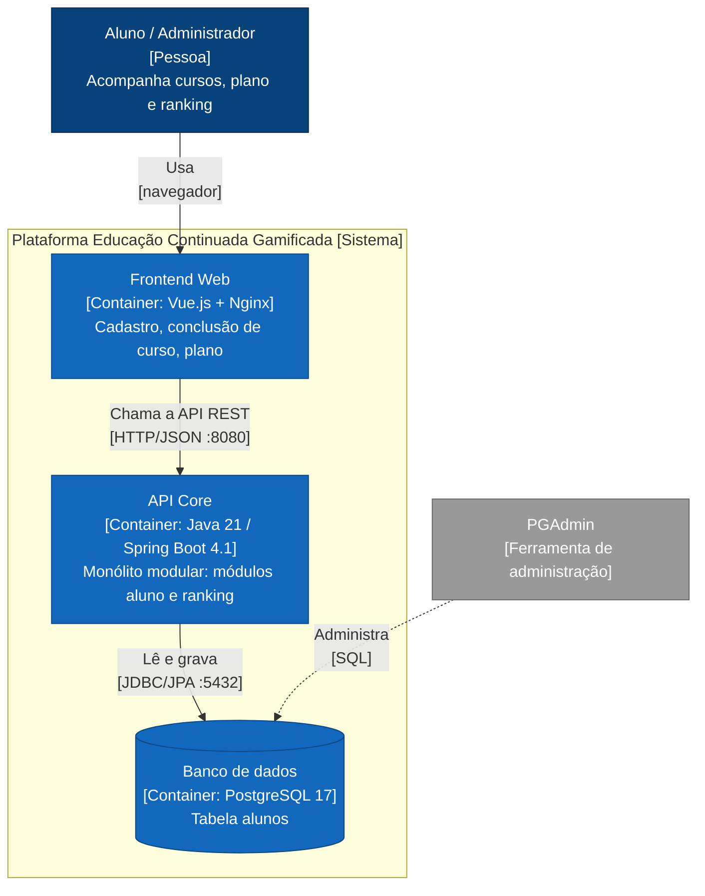
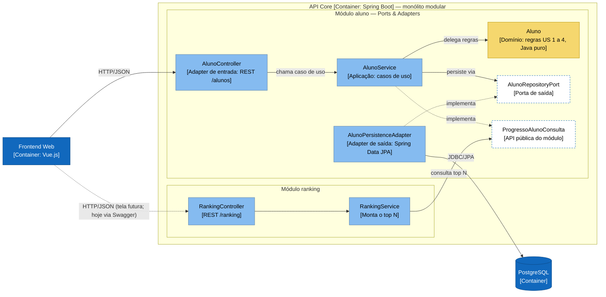

# Registro Arquitetural — Educação Continuada Gamificada (Grupo 7)

Registro vivo do **Exercício B1 — Architecture Lab**. Cada desafio deixa uma decisão rastreável:

> **RF → RNF (FURPS+) → ASR + RPC → alternativas/trade-offs → ADR → C4 → evidência**

Regra de ouro usada na revisão: o C4 é explicado pelo ADR; o ADR é sustentado pelos ASRs e RPCs; os ASRs derivam de RF/RNF; a evidência mostra que o raciocínio é plausível.

| Desafio | Tema | ADR | C4 | Evidência | Status |
|---|---|---|---|---|---|
| 1 | Drivers e evolução do Core | [ADR-001](#18-adr-001--monólito-modular-para-o-core) | [Container](#19-c4--container) | [desafio-1](evidencias/desafio-1) | Concluído |
| 2 | Organização interna do Core | [ADR-002](#28-adr-002--ports--adapters-no-módulo-aluno) | [Component](#29-c4--component-do-core) | [desafio-2](evidencias/desafio-2) | Concluído |
| 3 | Serviço Python e IA | — | — | — | Pendente |
| 4 | Comunicação e eventos | — | — | — | Pendente |
| 5 | IoT e MQTT | — | — | — | Pendente |
| 6 | CI/CD e observabilidade | — | — | — | Pendente |

---

## 0. Case-base e premissas globais

**Sistema de partida (AC1):** frontend Vue.js servido por Nginx, API Java 21 / Spring Boot 4.1, PostgreSQL 17, tudo em Docker Compose. Equipe de 6 desenvolvedores. O domínio implementado cobre as US 1 a 4 (plano, voucher, cursos extras, notificação de mudança de plano).

### Requisitos funcionais do B1 e como aparecem no código

| RF | Descrição | Origem no produto | Onde está |
|---|---|---|---|
| RF01 | Ranking | Novo no B1 (mínimo: top N por cursos concluídos) | módulo `ranking`, `GET /ranking` |
| RF02 | Conquistas e regras de gamificação | US 2 (12 cursos → PREMIUM + voucher), US 1/US 4 (média ≥ 7,0 → 3 cursos extras), US 3 (registro de notificação) | `aluno.domain.Aluno` |
| RF03 | Recomendação inteligente | — | Desafio 3 |
| RF04 | Assistente educacional (RAG/LLM) | — | Desafio 3 |
| RF05 | Notificações | US 3 (hoje é um `PUT /notificar` manual) | Desafio 4 |
| RF06 | Eventos IoT | — | Desafio 5 |

> **Premissa:** o produto ainda não tem moedas nem badges. Neste registro, "conquistas" corresponde às recompensas que já existem (plano PREMIUM, voucher e cursos extras). Moedas e badges entram como novas regras do domínio, sem alterar a estrutura decidida no ADR-002.

### RPCs globais (valem para todos os desafios)

| ID | Restrição / premissa | Tipo |
|---|---|---|
| RPC-01 | O Core permanece em Java/Spring Boot | Tecnologia / legado |
| RPC-02 | Equipe de 6 desenvolvedores, sem time de plataforma dedicado | Equipe |
| RPC-03 | Banco relacional (PostgreSQL) e dados da AC1 | Legado / dados |
| RPC-04 | O contrato HTTP/JSON usado pelo frontend Vue não pode quebrar sem ajuste coordenado | Integração |
| RPC-05 | Ambiente de execução em Docker Compose | Infraestrutura |

---

## Matriz cumulativa de ASRs

Só entram aqui RNFs capazes de alterar estrutura, comunicação, dados, implantação ou operação. O ID do ASR é permanente; desafios futuros acrescentam linhas ou atualizam o status.

| ID | ASR (cenário) | RNF / FURPS+ | Desafio | Altera | ADR | Evidência | Status |
|---|---|---|---|---|---|---|---|
| ASR-01 | Uma mudança em uma capacidade (ex.: ranking) deve alterar só o módulo dela; outro módulo só a acessa pela API pública | Manutenibilidade / **S** | D1 | Estrutura | ADR-001 | `ArquiteturaModularTest` + grafo jdeps | Atendido |
| ASR-02 | Com até 100.000 usuários, o ranking (leitura que mais cresce) não pode carregar todos os alunos nem competir com a conclusão de curso; deve ser extraível sem reescrever o aluno | Escalabilidade e desempenho / **P** | D1 | Dados, implantação futura | ADR-001 | Consulta top N paginada + fronteira `aluno.api` | Parcial: carga a medir no D6 |
| ASR-03 | A arquitetura deve continuar operável por 6 devs: um artefato implantável enquanto não houver necessidade medida de deploy ou escala independente | Complexidade operacional / **S** (+ restrição de equipe) | D1 | Implantação, operação | ADR-001 | Compose segue com 1 container de backend | Atendido |
| ASR-04 | Alterar uma regra de gamificação (ex.: 12 cursos, média 7,0) deve exigir mudança em um único lugar, o domínio, sem tocar controller nem banco | Modificabilidade / **S** | D2 | Estrutura interna, dependências | ADR-002 | Regra dos 12 cursos: 2 lugares → 1; `ArquiteturaHexagonalTest` | Atendido |
| ASR-05 | Regras e casos de uso devem ser testáveis sem Spring e sem banco; o adapter de persistência deve ser trocável sem mudar os testes do domínio | Testabilidade / **S** | D2 | Estrutura (portas) | ADR-002 | Contrato da porta rodando em 2 adapters; 23 testes de comportamento sem infraestrutura | Atendido |
| ASR-06… | Deploy independente da IA, tolerância a falhas, idempotência de eventos, observabilidade… | — | D3–D6 | — | — | — | A definir |

---

# Desafio 1 — Drivers e evolução do Core

**Pergunta:** manter o monólito em camadas, evoluir para monólito modular ou separar capacidades em serviços, num cenário de 1.000 → 100.000 usuários em que o ranking cresce mais que o resto?

## 1.1 RF

- **RF01 Ranking:** não existia na AC1. Criado no módulo `ranking` (`GET /ranking?limite=N`, top N por cursos concluídos).
- **RF02 Conquistas:** regras das US 1 a 4, que continuam evoluindo.
- Evolução das funcionalidades existentes (cadastro, conclusão de curso, liberação de cursos, notificação).

## 1.2 RNF analisados (FURPS+)

| RNF | FURPS+ | Leitura no cenário | Vira ASR? |
|---|---|---|---|
| Manutenibilidade | S | As 4 US cresceram no mesmo controller, e novas capacidades (IA, eventos, IoT) vão chegar | **Sim → ASR-01** |
| Desempenho | P | O ranking é a leitura mais frequente | Incorporado ao ASR-02 (mesma causa) |
| Escalabilidade | P | 100× mais usuários, com crescimento concentrado no ranking | **Sim → ASR-02** |
| Testabilidade | S | Os testes cobriam um domínio que a API não usava | Não neste desafio: não muda a decisão macro. Vira o **ASR-05** no D2 |
| Complexidade operacional | S (+) | 6 devs, Docker Compose, sem time de plataforma | **Sim → ASR-03** |

## 1.3 ASRs selecionados (máx. 3)

1. **ASR-01 Manutenibilidade.** Altera a **estrutura**: o código passa a ser organizado por capacidade de negócio, com uma API pública por módulo, em vez de camadas técnicas compartilhadas.
2. **ASR-02 Escalabilidade do ranking.** Altera os **dados** (consulta top N paginada no banco, não `findAll`) e prepara a **implantação** futura: o ranking pode virar serviço sem mexer no aluno.
3. **ASR-03 Complexidade operacional.** Altera **implantação e operação**: mantém um único artefato até existir evidência que justifique distribuir.

## 1.4 RPCs aplicáveis

- RPC-01 Core em Java/Spring Boot.
- RPC-02 Equipe de 6 desenvolvedores.
- RPC-03 Banco relacional e legado da AC1.
- RPC-04 Contrato JSON do frontend mantido.

## 1.5 Decisão do Tech Lead

- **Quais RNFs viram ASR?** Manutenibilidade, escalabilidade (com desempenho junto) e complexidade operacional. Testabilidade fica para o D2, onde é ela que decide a estrutura interna.
- **Há necessidade comprovada de escala ou deploy independente?** **Ainda não.** O Core tem 1 entidade, 1 tabela e nenhuma medição mostrando o ranking competindo por recursos com a conclusão de curso. Os 100.000 usuários são uma projeção. A resposta proporcional é tirar o gargalo óbvio (consulta paginada no banco) e deixar a fronteira pronta para extrair o ranking. A medição fica para o D6 (Prometheus/Grafana).
- **A complexidade distribuída é justificável?** Não para o Core. Serviços exigiriam rede entre módulos, consistência eventual, rastreamento distribuído e um pipeline por serviço, tudo com 6 pessoas. A capacidade de IA em Python, que tem outra stack e outro ciclo de vida, será decidida no D3 por ASRs próprios.

## 1.6 Alternativas e trade-offs

| | (A) Monólito em camadas (AC1) | **(B) Monólito modular** | (C) Decomposição seletiva (ranking como serviço) |
|---|---|---|---|
| Como fica | Pacotes `Controller/Service/Repository/Entity` compartilhados por todas as funcionalidades | Pacotes por capacidade (`aluno`, `ranking`), cada módulo com API pública; 1 deploy | Ranking em serviço próprio, com banco/cache próprio e comunicação HTTP ou eventos |
| Ganha | Simplicidade imediata | Fronteiras explícitas e testáveis; extração futura barata; zero custo operacional novo | Escala e deploy independentes do ranking |
| Perde | Qualquer classe acessa entidade e repositório; o crescimento espalha acoplamento (o controller já duplicava regras) | Escala ainda conjunta (o ranking escala junto com o Core) | +1 pipeline, +1 banco ou réplica, consistência eventual do placar, latência de rede, observabilidade distribuída |
| Atende ASR-01 / 02 / 03 | ✗ / parcial / ✓ | ✓ / ✓ (preparado) / ✓ | ✓ / ✓ / ✗ |
| Veredito | Rejeitada | **Escolhida** | Adiada até haver medição (gatilho no ADR-001) |

## 1.7 Evidência (mini-lab)

**Hipótese:** reorganizar por capacidade, com API pública explícita, reduz o acoplamento entre funcionalidades sem custo operacional, e a fronteira pode ser verificada automaticamente.

**Procedimento**
1. Grafo de dependências das classes compiladas **antes** da mudança, gerado com `jdeps` a partir da versão em camadas da AC1 ([commit `4ae2fd0` do repositório da AC1](https://github.com/KauanHYT/devops-ac1---entrega-final-atdd-em-spring-boot-e-docker/tree/4ae2fd0)).
2. Reorganização: `aluno/` (com `api/`) e o novo `ranking/`, que consome só `aluno.api.ProgressoAlunoConsulta`.
3. Grafo **depois** e regras ArchUnit em [`ArquiteturaModularTest`](../../src/test/java/com/grupo7/ac1final/arquitetura/ArquiteturaModularTest.java).

| Antes (AC1) | Depois (D1) |
|---|---|
|  |  |

| Medida | Antes | Depois |
|---|---|---|
| Organização | Por camada técnica (`Controller`, `Service`, `Repository`, `Entity`, `DTO`, `Domain`) | Por capacidade: módulos `aluno` e `ranking` |
| Fronteira pública entre funcionalidades | Nenhuma: qualquer classe acessa `AlunoEntity` e o repositório | `aluno.api`, com 2 tipos |
| Dependências do ranking (jdeps) | — | Somente `aluno.api` + Spring Web/Core |
| Consulta do ranking | — | Top N paginado no banco (`findAllByOrderByCursosConcluidosDescIdAsc(Pageable)`) |
| Regras de fronteira verificadas no build | 0 | 3 (ranking → só `aluno.api`; aluno não depende de ranking; módulos sem ciclos) |
| Ciclos entre módulos | n/a | 0 |
| Artefatos implantáveis | 1 | 1 (sem custo operacional novo) |
| Observação | O pacote `Domain` não era usado por nenhuma classe | Resolvido no D2 |

Dados brutos: [`dependencias-antes.txt`](evidencias/desafio-1/dependencias-antes.txt) e [`dependencias-depois.txt`](evidencias/desafio-1/dependencias-depois.txt).

**Como reproduzir**
```bash
./mvnw test -Dtest=ArquiteturaModularTest,RankingServiceTest
./mvnw -q compile && jdeps -verbose:package target/classes
```

**Limitação assumida:** a escalabilidade não foi medida com carga. O ASR-02 fica "Parcial" até o D6 instrumentar a latência de `/ranking` e de `/concluir-curso`.

## 1.8 ADR-001 — Monólito modular para o Core

- **Status:** Aceito (2026-11-01). Substitui o ADR resumido do registro da AC2.
- **Contexto:** crescimento projetado de 1.000 para 100.000 usuários, com o ranking crescendo mais que o resto. O Core da AC1 era organizado por camada técnica, sem fronteira entre funcionalidades, e o controller já duplicava regras do domínio.
- **ASRs / RPCs:** ASR-01, ASR-02, ASR-03 · RPC-01, RPC-02, RPC-03, RPC-04.
- **Alternativas:** (A) monólito em camadas; (B) monólito modular; (C) ranking como serviço. Comparação em 1.6.
- **Decisão:** adotar **(B)**. O Core passa a ser dividido em módulos por capacidade (`aluno`, `ranking`). A comunicação entre módulos só passa por APIs públicas (`aluno.api`), e as regras de fronteira viram testes ArchUnit. O deploy continua único.
- **Consequências:**
  - (+) Fronteiras explícitas e verificadas no build.
  - (+) Extrair o ranking passa a ser trocar a implementação de `ProgressoAlunoConsulta` por um cliente HTTP ou de eventos.
  - (+) Nenhum container ou pipeline novo.
  - (−) Ranking e aluno ainda escalam juntos e compartilham o banco.
  - (−) A disciplina de fronteira depende dos testes ArchUnit continuarem no pipeline (D6).
- **Revisitar quando:** métricas do D6 mostrarem que a carga do ranking degrada a latência p95 da conclusão de curso, que o ranking precisa de réplica ou cache próprio, ou que a equipe cresceu a ponto de times diferentes cuidarem de módulos diferentes.

## 1.9 C4 — Container

A decisão é interna ao Core: a visão de containers não ganha elementos novos, mas o Core passa a ser descrito como monólito modular. A organização interna aparece no C4 Component (Desafio 2).



---

# Desafio 2 — Organização interna do Core

**Pergunta:** como evitar que domínio, banco, framework e integrações fiquem acoplados, se as regras de ranking, moedas, badges e recompensas mudam com frequência?

## 2.1 RF

- **RF01 Ranking:** consome o progresso dos alunos pela API do módulo.
- **RF02 Conquistas e regras de gamificação:** US 2 (12 cursos → PREMIUM + voucher), US 1/US 4 (média ≥ 7,0 → 3 cursos extras), US 3 (notificação só para PREMIUM).

## 2.2 RNF analisados (FURPS+)

| RNF | FURPS+ | Leitura no código da AC1 | Vira ASR? |
|---|---|---|---|
| Modificabilidade | S | A regra dos 12 cursos existia em 2 lugares (`Aluno` e `AlunoController`) e a da média já divergia: a API liberava 3 cursos sem olhar a média | **Sim → ASR-04** |
| Testabilidade | S | Os 7 testes cobriam uma classe que nenhuma classe de produção usava; testar a API exigia Spring + banco | **Sim → ASR-05** |
| Manutenibilidade | S | Já tratada no nível de módulos pelo ASR-01 | Não (evita duplicar ASR) |
| Facilidade de evolução | S | É consequência de ASR-01 + ASR-04 | Não |

## 2.3 ASRs selecionados

1. **ASR-04 Modificabilidade das regras.** Altera a **estrutura interna**: a regra mora só no domínio, e controller e persistência ficam proibidos de reimplementá-la.
2. **ASR-05 Testabilidade.** Altera as **dependências**: a aplicação passa a depender de uma porta (interface), e não do JPA. Assim, domínio e casos de uso rodam com um adapter falso.

Ficamos com 2 ASRs de propósito: os outros RNFs já estão cobertos por ASRs existentes.

## 2.4 RPCs aplicáveis

- O Core continua em Spring Boot (RPC-01). Não vamos tirar `@Service`/`@Transactional` da camada de aplicação.
- As regras existentes devem ser reaproveitadas: a classe `Aluno` e seus 7 testes seguem sem mudança de comportamento. Só ganharam `id`, `getCursosConcluidos()` e `reconstituir(...)`.
- É proibido reescrever o produto. O contrato JSON foi mantido (RPC-04), com uma única mudança: `PUT /alunos/{id}/liberar-cursos` passa a exigir `?media=`, porque a regra das US 1 e 4 depende da média. O frontend foi ajustado junto.

## 2.5 Decisão do Tech Lead

- **Qual dependência realmente precisa ser invertida?** A da **persistência**. Na AC1, o controller dependia da entidade JPA e reimplementava a regra. Agora a aplicação depende de `AlunoRepositoryPort`, e o JPA fica num adapter que implementa essa porta. O framework web não precisa de inversão: o controller já é borda e só passou a delegar.
- **O custo estrutural é proporcional?** Sim, porque foi aplicado só onde as regras mudam: o módulo `aluno`, com 1 porta, 1 adapter JPA e 1 record de entrada. O módulo `ranking`, que não tem regra própria, continua simples. Não criamos uma classe por caso de uso, presenters nem mappers genéricos.
- **DDD, Hexagonal, Clean e Onion são concorrentes?** Não, eles se **combinam**:
  - **Hexagonal** define a borda: portas e adapters.
  - **Clean/Onion** define a regra de dependência: tudo aponta para o domínio.
  - **DDD** contribui com a entidade rica (`Aluno` com comportamento e linguagem do negócio) e com o recorte de módulos por capacidade.
  - Não adotamos DDD tático completo (agregados formais, eventos de domínio), porque ainda não há complexidade que pague esse custo. Eventos de domínio podem surgir no D4.

## 2.6 Alternativas e trade-offs

| | (A) Estrutura atual (camadas, controller + entidade) | **(B) Ports & Adapters no módulo aluno** | (C) Clean Architecture completa |
|---|---|---|---|
| Como fica | Controller manipula `AlunoEntity` e aplica regras; service é repasse do repositório | Domínio puro ← aplicação (casos de uso) ← adapters web e JPA, via porta | Uma classe por caso de uso, presenters, gateways, aplicação sem nenhuma anotação Spring |
| Ganha | Menos arquivos | Regra em 1 lugar; casos de uso testáveis sem infraestrutura; JPA isolado num pacote | Isolamento máximo do framework |
| Perde | Regras duplicadas e divergentes; testes não cobrem o que roda | +1 porta e +1 adapter; tradução entidade ↔ domínio | Muitos tipos para 1 entidade; contraria "não reescrever o produto" |
| ASR-04 / ASR-05 | ✗ / ✗ | ✓ / ✓ | ✓ / ✓ |
| Veredito | Rejeitada | **Escolhida** | Rejeitada por custo desproporcional |

## 2.7 Evidência (mini-lab)

**Hipótese:** com a dependência de persistência invertida, a regra de domínio fica num só lugar e testável sem infraestrutura, e o adapter de persistência pode ser trocado sem mudar domínio nem testes de domínio.

**Procedimento**
1. A API passou a chamar o domínio `Aluno`, e a regra duplicada no controller foi removida.
2. Foi criada a porta `AlunoRepositoryPort`, com dois adapters: `AlunoPersistenceAdapter` (JPA, produção) e `AlunoRepositoryEmMemoria` (fake, testes).
3. O mesmo conjunto de testes de contrato ([`AlunoRepositoryPortContrato`](../../src/test/java/com/grupo7/ac1final/aluno/application/port/AlunoRepositoryPortContrato.java)) roda contra os dois adapters.
4. As regras de dependência viraram testes em [`ArquiteturaHexagonalTest`](../../src/test/java/com/grupo7/ac1final/arquitetura/ArquiteturaHexagonalTest.java).


| Medida | Antes (AC1) | Depois (D2) |
|---|---|---|
| Lugares onde a regra dos 12 cursos está escrita | 2 (`Aluno`, `AlunoController`) | **1** (`Aluno`) |
| Classes de produção que usam o domínio `Aluno` | **0** | 5 |
| Classes que dependem de JPA / Spring Data / entidade | 4 (incluindo controller e service) | 3, todas em `aluno.adapter.persistence` |
| Regra "média ≥ 7,0" na API | Ignorada (sempre liberava 3) | Aplicada pelo domínio (teste de regressão) |
| Adapters da porta exercitados pelo mesmo contrato | — | 2 (memória e JPA/H2), 5 testes cada |
| `AlunoTest` (testes de domínio originais) | 7 | 7, sem alteração (só mudou o pacote) |
| Testes de comportamento que rodam sem Spring e sem banco | 7 | 23 |
| Total de testes da suíte | 8 | 39 |
| Regras de arquitetura no build | 0 | 4 hexagonais + 3 modulares |

**O que cada suíte prova**

| Suíte | Prova | Precisa de Spring/banco? |
|---|---|---|
| `AlunoTest`, `AlunoReconstituidoTest` | Regras US 1 a 4 no domínio puro | Não |
| `AlunoServiceTest` | Casos de uso com adapter em memória, incluindo a regressão da média | Não |
| `AlunoRepositoryEmMemoriaTest` | Contrato da porta no adapter fake | Não |
| `AlunoPersistenceAdapterJpaTest` | **O mesmo contrato** no adapter JPA (`@DataJpaTest`, H2) | Sim |
| `AlunoApiIntegrationTest` | HTTP → caso de uso → domínio → JPA, e `/ranking` | Sim |
| `ArquiteturaHexagonalTest`, `ArquiteturaModularTest` | Direção das dependências e fronteiras de módulo | Não (análise de bytecode) |

**Resultado da suíte completa (2026-11-02):** `Tests run: 39, Failures: 0, Errors: 0, Skipped: 0`, BUILD SUCCESS. São 31 testes de comportamento e 7 regras de arquitetura, mais o `contextLoads`.


**Como reproduzir**
```bash
./mvnw test
```

**Dívida registrada:** o cadastro (`POST /alunos`) ainda aceita estado inicial vindo do cliente (comportamento da AC1, preservado pela RPC). Isso permite criar um aluno PREMIUM com 0 cursos, e vira candidato a regra de domínio quando entrarem moedas e badges.

## 2.8 ADR-002 — Ports & Adapters no módulo aluno

- **Status:** Aceito (2026-11-01).
- **Contexto:** as regras de gamificação mudam com frequência. Na AC1, o controller manipulava a entidade JPA e reimplementava regras: a dos 12 cursos estava duplicada e a da média divergia do domínio. Já o domínio testado não era usado pela API.
- **ASRs / RPCs:** ASR-04, ASR-05 · RPC-01, RPC-04, "reaproveitar regras", "não reescrever o produto".
- **Alternativas:** (A) manter camadas; (B) Ports & Adapters no módulo aluno, seguindo a regra de dependência de Clean/Onion; (C) Clean Architecture completa. Comparação em 2.6.
- **Decisão:** adotar **(B)**. O módulo `aluno` fica dividido em:
  - `domain`: Java puro;
  - `application`: casos de uso e a porta `AlunoRepositoryPort`;
  - `adapter.web`: REST;
  - `adapter.persistence`: JPA;
  - `api`: interface pública para outros módulos.

  A aplicação pode usar anotações Spring (`@Service`, `@Transactional`), mas nunca JPA nem adapters. As regras são verificadas com ArchUnit.
- **Consequências:**
  - (+) Cada regra está num lugar só.
  - (+) Casos de uso testáveis em milissegundos.
  - (+) Trocar o banco ou o ORM afeta um único pacote.
  - (+) O D3/D4 poderá acrescentar adapters (cliente da IA, publicador de eventos) sem tocar no domínio.
  - (−) Tradução entidade ↔ domínio no adapter.
  - (−) Mais tipos para quem chega ao código.
  - (−) A camada de aplicação continua acoplada ao Spring, por escolha consciente (RPC-01).
- **Revisitar quando:** o domínio ganhar várias entidades com invariantes entre si (aí avaliar agregados DDD) ou quando a aplicação precisar rodar fora do Spring.

## 2.9 C4 — Component do Core



---

# Próximos desafios: hipóteses herdadas, ainda não decididas

O registro da AC2 antecipou algumas decisões sem o padrão completo. Elas ficam aqui só como **hipóteses**. Cada uma será decidida no seu desafio, com ASRs, alternativas e evidência próprias.

| Desafio | Hipótese de partida | Gancho já existente no código |
|---|---|---|
| D3 — IA | Serviço Python independente, consumido pelo Core com timeout e degradação | Novo adapter de saída ao lado de `AlunoPersistenceAdapter` |
| D4 — Eventos | A notificação da US 3 sai do `PUT /notificar` manual e passa a reagir ao evento "aluno virou PREMIUM" | `AlunoService.concluirCurso` é o ponto de publicação |
| D5 — IoT | MQTT + gateway chamando o Core | `PUT /concluir-curso` **não é idempotente** (cada chamada soma 1), o que vira ASR de deduplicação |
| D6 — CI/CD | Jenkins rodando `./mvnw verify` (inclui ArchUnit) antes da imagem; Prometheus medindo `/ranking` e `/concluir-curso` | Valida o ASR-02 e protege ADR-001/002 no pipeline |

# Histórico

- **AC2:** "Decisões Arquiteturais — Desafio 1" (substituído por este registro). Correção conceitual: aquele texto chamava de "monólito modular" a divisão `Domain/Service/Controller`, que é um monólito **em camadas**. A modularização por capacidade foi feita de fato no Desafio 1 do B1.
- **B1-D1** (2026-11-01): ADR-001, módulos `aluno` e `ranking`.
- **B1-D2** (2026-11-01): ADR-002, Ports & Adapters no módulo `aluno`. Suíte completa validada em 2026-11-02 (39 testes, 0 falhas).
- **Repositórios:** a versão em camadas (AC1) permanece no repositório original. A versão modular (B1) está neste repositório, conforme orientação da professora.

# Síntese para a PoC da AF

*A preencher ao final do B1.* Até aqui seguem para a PoC: ADR-001 (monólito modular com fronteiras testadas) e ADR-002 (domínio isolado por portas).
